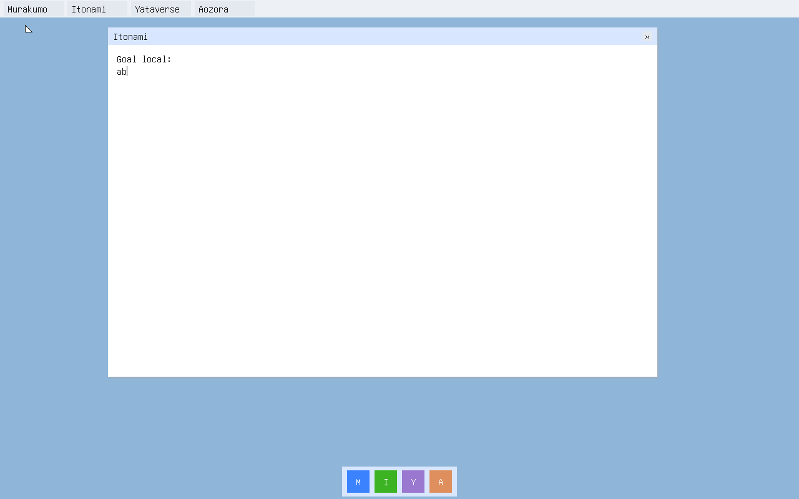

# Native Itonami local draft with an interactive fuel budget

The earlier native desktop's `2^30` fuel budget expired during ordinary
interaction (AIUEOS #506). This branch applies the same admitted `2^53-1`
initial budget to both the normal desktop and the opt-in `local-draft`
profile from AIUEOS #508. Both observers now read the running kernel's fuel
counter after its first completed frame and reject a value below `2^52`.
The budget is finite, and this gate is not a long-duration endurance test.

The pinned Amu ARM Linux selfhost root compiled the locked 31-module
`local-draft` kernel twice to byte-identical ELF/EFI outputs and built the
diagnostic media. The default desktop was built separately with persistence
disabled. Exact source, compiler, image and media digests are in
[build.json](build.json).

[draft-restart.json](draft-restart.json) records 11 QEMU events: native F5
commit, a new process restoring the draft, uncommitted edit followed by
SIGKILL and recovery of the last commit, alternate generation, unpublished
slot handling and seven damaged or missing media refusals. Each cold boot
passed the live fuel threshold. The restored text was rendered in a completed
frame:

[default-desktop.json](default-desktop.json) records 12 normal-profile QEMU
events, including input, rendering, F5 persistence disabled and an actual
first-frame fuel count of `9007199249220410`.

The two old `2^30` images were booted as negative controls. Both observers
refused them before input, at live fuel counts `1066510643` (local draft)
and `1068905237` (normal desktop). Their pinned image identities and results
are in [fuel-refusals.json](fuel-refusals.json).

The guest is freestanding AIUEOS with no Linux guest or NIC. Its producer
still ran the Amu compiler in a local ARM Linux container. This is a local,
plaintext, unsigned draft transport on a marked scratch disk. It does not
qualify D2 workspace images, a registered Itonami agent/dapp, fresh operation
consent, shared Browser/CSSOM, physical hardware, release, or Linux-free
build closure. The current `local-draft` build remains a diagnostic profile.
