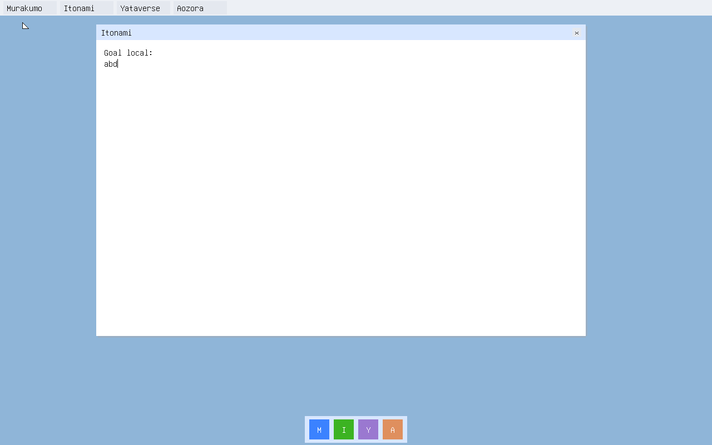

# Local native draft commit / cold restore — 2026-10-25

Status: `PASS_NATIVE_LOCAL_DRAFT_COLD_RESTORE` for the opt-in native diagnostic.
AWAI-90 and JUN-145 remain open. Scope and remaining owner connections are in
[the integration record](../../native-workspace-restore-progress.md).

The pinned Amu ARM Linux static root compiled the locked 31-module AIUEOS
kernel twice and reproduced the ELF and PCI v6 EFI. Native font/media tools
produced and verified the diagnostic boot medium. QEMU TCG booted the kernel
directly, without a Linux guest or NIC. The source binding is in
[native-build.json](native-build.json); media producer/independent-reader
controls are in [native-media.json](native-media.json).

[native-draft-restart.json](native-draft-restart.json) records:

- native F5 commit of `ab`, generation 1, with real slot/head writes;
- a new QEMU process restores `ab` with zero input events and no open window;
- after editing `abc` without commit, SIGKILL and another fresh boot restore
  `ab`; durable bytes did not change;
- another native commit produces `abd`, generation 2, in the alternate slot;
- a valid higher-generation orphan slot cannot supersede the published head;
- seven refusals: tampered slot, unsupported head version, dirty empty head,
  nonzero reserved head bytes, valid digest with invalid goal code point,
  unprovisioned medium and missing medium. F5 then refuses without writes.

The boot-medium hash, provisioning sector and bytes beyond the allowed journal
remain unchanged. SHA-256 slot output is independently read back against
Python hashlib. Screenshots wait for the guest's completed framebuffer render;
QMP does not synthesize the UI or write the restored text.

The normal desktop profile also reproduced through native font/kernel/EFI/media
and passed its existing QEMU input/PCI/GOP/font gate, including F5 remaining
disabled. See [normal-desktop-qemu.json](normal-desktop-qemu.json).

This proves bounded local draft durability only. No D2 canonical workspace
codec, signed head, release admission, registered dapp, shared Browser/CSSOM,
private-workspace encryption, distributed storage or physical hardware is
qualified. Valid whole-disk rollback and a torn ATA head write are not covered.
Compiler/controller Linux-free build closure remains separate.

