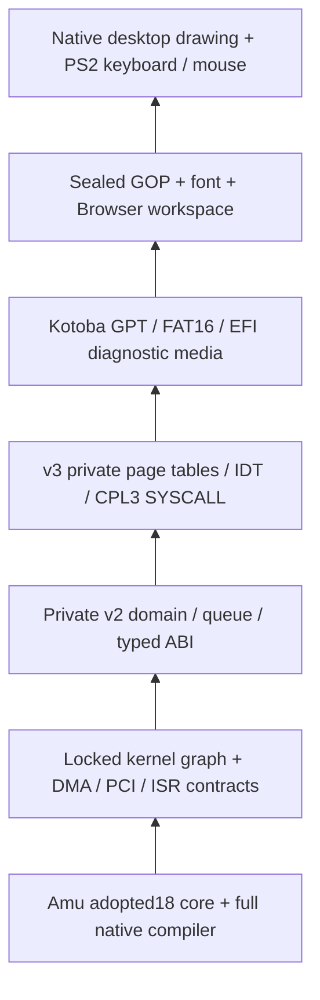

# Native diagnostic media and desktop/input

AIUEOS owns the OS, framebuffer and input surface. Itonami GUI is the human
entry to an agent-first workspace; an Awai Node Console would own node setup,
resources and observation. Murakumo names the dedicated hardware that can host
an Awai Node. These UI and node roles do not require a Linux guest.

AIUEOS is the common OS foundation; **Itonami OS is its Awai distribution in
this same repository**. `build-native-desktop.py --distribution awai` (or
`AIUEOS_DISTRIBUTION=awai` in the shell wrapper) stages and digest-binds the
[distribution descriptor](../distributions/README.md). Both selections use
identical core producers. This candidate metadata does not install the
intended app/node components, change runtime/assurance profiles, or qualify
a distribution release. See [ADR0274](adr/0274-awai-os-is-an-aiueos-distribution.md).

The native closure follows this order (lower layers supply the upper ones):

Current local candidates reproduce all31 modules, including the complete kernel
and live runtime. Nothing supplies a C/reference kernel, object file or
hosted compiler/packager. `build-kotoba-native-desktop.sh` now invokes
`build-native-desktop.py`; a hosted bootstrap request refuses. Select an
actual native Linux compiler and its immutable SHA256 with
`AIUEOS_AMU_SELFHOST_BIN` and `AIUEOS_AMU_SELFHOST_SHA256`. Owner dependency
roots are the same pinned inputs used by `build-native-kernel.py`.

The wrapper invokes three native producers: `font-pad.kotoba` preserves the
checked-in licensed font bytes and pads them to512KiB; Amu compiles the full
locked kernel and packages its EFI with that exact payload;
`media-builder.kotoba` emits the deterministic8MiB GPT/FAT16 diagnostic ESP.
Python stages, hashes, invokes and independently reads the results. It does
not emit any kernel, EFI, font or disk format. The original font asset is
input data; the legacy hosted font generator is outside this closure.

On Apple Silicon, the same desktop entry selects the signed Mac Amu compiler
and Kotoba packager, then runs the native font, kernel, EFI, media and
passwordless QEMU input gate together. The Mac route requires immutable
compiler/packager pins and a new task workspace output. Its
[integrated receipt](../docs/evidence/aiueos-mac-integrated-20261026/README.md)
binds all four stages and confirms visible Itonami Goal glyph pixels.

GOP metadata is sealed before any Kotoba body runs. Its framebuffer must
fit wholly inside an allocated private PCI BAR. The image exposes complete
4KiB framebuffer pages, validated dimensions/stride/format, an8192-byte
Browser surface at context+0x238000, an8192-byte renderer/input context at
0x23a000, and the exact padded font. These workspaces do not overlap DMA
slots0..13, the CPU RX snapshot at slot14, the live queue, arenas, tables or
legacy FPU state. The paired v6 loader owns the font payload offset/extent.
Width/height scalars and pointers loaded from boot metadata grant no region.

Before desktop execution, the diagnostic root registers domain73, enables
the image's private page tables and IDT, and remains in CPL0. It polls PS2
devices with interrupts disabled. This is not a preemptive scheduler or
proof of user-mode dapp execution. Its Browser-frame2 adapter is the
existing bounded behavior mirror; actual Browser/CSSOM parity remains open.
The four diagnostic cards perform no network operation, inference or dapp
command. The native Itonami card accepts a bounded lowercase ASCII goal draft
in its own 64-code-point surface slot. Typing and Backspace update RAM only;
closing the card does not submit the goal, invoke an agent loop, or persist it.
This is a native AIUEOS UI entry with no Linux guest or host text service.

An explicit `build-native-desktop.py --profile local-draft` candidate enables
bounded native disk commit/cold restore for that diagnostic text. The default
profile retains RAM-only behavior. The extra locked module is the draft store;
it uses reserved desktop-context scratch rather than DMA/snapshot pages. See
[AWAI-90 progress](native-workspace-restore-progress.md) for the source-bound
receipt and the still-open D2 image, shared Browser, user-target and release
connections. This optional probe is not registered dapp/workspace execution.

`check-native-desktop-qemu.py` boots raw media on QEMU q35 SATA using a
temporary overlay and no NIC. It checks sealed PCI/GOP/font bytes, native
page-table/domain state, completed frames, keyboard open/close operations,
mouse movement/click/release and changed screenshots. It checks that the
Itonami goal changes from keyboard input and returns to the previous text on
Backspace, and that the original media digest is unchanged. QEMU TCG is guest
emulation; native
compiler execution, controller qualification and physical-hardware boot are
distinct proof surfaces. Virtio block boot and general installer/media
compatibility are not qualified by this diagnostic.

Kernel/EFI/media binaries containing private owner code stay local or in
the owner's private consumer CI. Public changes contain source and bounded
receipts, without distributing these diagnostic binaries.
