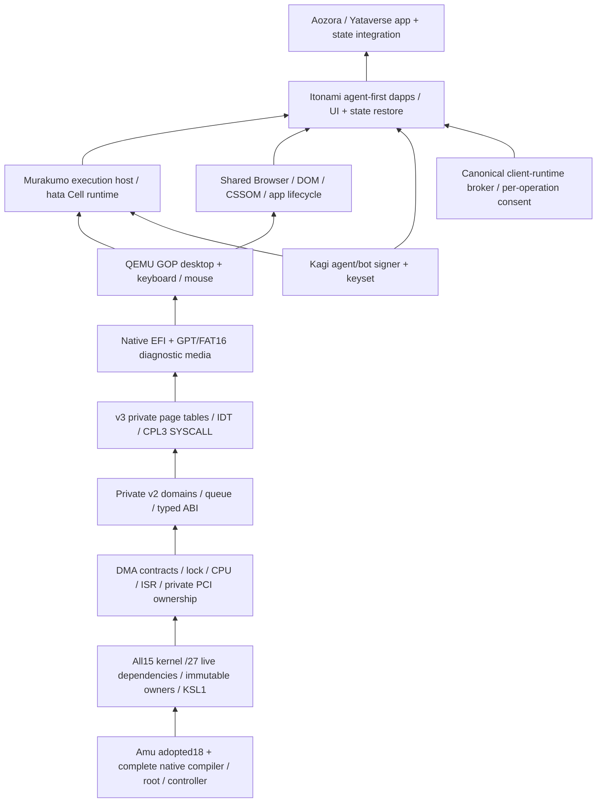

# AIUEOS native integration gates

Owner order: native compiler adoption, complete kernel dependencies and
locks, DMA/ISR/live ABI, native media, then QEMU desktop/input. Shared
Browser/CSSOM and Itonami depend on that guest foundation. This ledger
records proof surfaces; it does not assign a whole-OS maturity score.

The lower box supplies the box above it. Murakumo is the execution host;
Itonami is the agent-first workspace/app role. The Mac's Linux VM/browser
console and the AIUEOS diagnostic guest are distinct environments.

| Gate | Evidence and qualification boundary | Linear |
| --- | --- | --- |
| Legacy CDCI removal | AIUEOS #491 deleted the JVM/NBB/C-reference workflow. Native consumer qualification now belongs in the source owner's CI, without a new cross-repository secret or hosted fallback. | JUN-64, AWAI-23 |
| Native compiler | Amu #1563 merged47c9462 with native ARM/x86 fixed points, all18 adopted core modules, controller, public aliases and DMA/PCI/ISR diagnostics. Successor full46 adoption must bind its current root/public/controller and gate pins to exact-head native CI. | JUN-31 |
| Complete source graph | Five immutable external owners; full15 kernel,27 live and30 desktop graphs; exact KSL1 roots/file set/digest; no declaration trimming. Source and artifact identities are recorded by `build-native-kernel.py`. | JUN-31 |
| DMA / private resources | Four bounded2048-byte RX slots inside the owned16KiB region, disjoint4KiB CPU snapshot at slot14, ten snapshot readback/refusal checks. PCI BAR ownership comes from the sealed native v6 catalog, never firmware memory-type inference. | JUN-31 |
| Live ABI | v2 has four non-evicting domains, per-domain arenas, a bounded queue/capability table and isolated completion/CAS state. Twelve context and sixteen typed-call checks have actual guest receipts; typed ABI roles are distinct from ISR roots. | JUN-31 |
| User entry | v3 owns page tables/IDT and W^X mappings, clears private registers/initial legacy FP state, validates return state and the complete104-byte request envelope. Eight actual CPL3/SYSCALL/fault cases have separate receipts. Preemption, extended-state switching and canonical value/token binding remain separate. | JUN-31 |
| Native media | Kotoba emits/reproduces an8MiB GPT/FAT16 diagnostic ESP. Independent CRC/FAT/EFI-byte readback and eleven refusal controls accompany the media. This is not a general installer/release or physical-disk qualification. | JUN-31, AWAI-23 |
| QEMU desktop/input | The full30 graph boots raw SATA media with a temporary overlay, enables private page tables/IDT/domain73, renders GOP frames, and responds to keyboard open/close and mouse move/click/release. Receipts include source/artifact bindings, completed-frame state, logs and screenshots. | JUN-31 |
| Browser/CSSOM / Itonami | Existing Browser-frame2 is a bounded diagnostic adapter; its unregistered-service cards prove guest UI only. Actual shared Browser/CSSOM, dapp lifecycle/state restore and broker controls are still separate gates. | JUN-93 |

Every new compiler candidate needs native self-rebuild, runtime corpus,
source-bound admission/refusal, actual x86 public/compiler/controller and
consumer receipts before adoption. A native ARM cross-built x86 image is a
candidate until it executes on x86. QEMU TCG is guest emulation, regardless
of the architecture running the compiler. Read the exact-head CI receipts
and source/image pins together; a compiler success does not qualify a whole
OS or a physical NIC.

## Native build and observation

`build-kotoba-native-kernel.sh AMU_SOURCE` invokes the locked native builder.
Its default is the source tree's pinned public ELF; a candidate override
requires `AIUEOS_AMU_SELFHOST_BIN` and `AIUEOS_AMU_SELFHOST_SHA256`, on the
matching native Linux architecture. Five owner inputs are pinned in
`os/aiueos/native/source-dependencies.json`. Native discovery supplies the
complete source set; immutable inputs and both outputs are read back.
`AIUEOS_NATIVE_KERNEL_SOURCE` selects an explicit graph and
`AIUEOS_NATIVE_OUT` selects a new output directory. Named failures remain
failures in `build-state.json`.

`build-kotoba-native-desktop.sh` calls the native-only font → locked
kernel/EFI → native diagnostic-media pipeline. Its hosted bootstrap option
refuses. Python stages/hashes/invokes/reads formats; Kotoba produces the
formats. The original licensed bitmap is input data and the native font
utility pads it to an owned512KiB payload. See
[native desktop/media](native-desktop-media-v1.md) and
[user entry](native-user-entry-v3-plan.md).

GOP must fit inside a sealed allocated PCI BAR. Browser surface/context
regions at private offsets0x238000/0x23a000 do not overlap DMA, slot14,
queues, arenas, tables or FPU state. Width/height and pointers loaded from
mutable boot metadata grant no memory region. The accepted diagnostic uses
QEMU q35 SATA with a temporary overlay; virtio block boot is not qualified.

## Boundaries and historical records

- No Node/NBB/JVM, C compiler/loader or legacy launcher fallback belongs in
  the accepted closure. Python orchestration is not a native CDCI verdict.
- Do not trim a graph or introduce a Browser/CSSOM mirror to make a smaller
  build pass. Do not relabel the existing diagnostic frame adapter as shared
  Browser/CSSOM parity. Preserve the owner CSSOM/Hermes worktrees and WIP.
- App origins distribute static artifacts. Shared end-user applications
  use the canonical client-runtime broker and fresh operation consent.
- Signer scope remains this Mac's local-software validation. Independent
  production custody and physical-machine qualification stay separate.
- Service connectivity/distributed inference is JUN-24; physical hardware
  is JUN-91; shared Browser/apps is JUN-93. They are not inferred from cards.
- Kernel/EFI/media containing private owner code remain local or in the
  owner's private CI. Public receipts do not distribute these binaries.

Earlier Amu #1547, full31/35/37 and hosted/reference records retain their
original source bindings in history and comments. #1563's
[native CI](https://github.com/kotoba-lang/amu/actions/runs/40114285929)
qualifies its own source/image set. Later source/image/controller adoption
has independent receipts. See also [DMA contracts](native-dma-region-contracts.md),
[PCI handoff](native-pci-resource-handoff.md), and
[live v2 context](native-live-context-v2.md).
