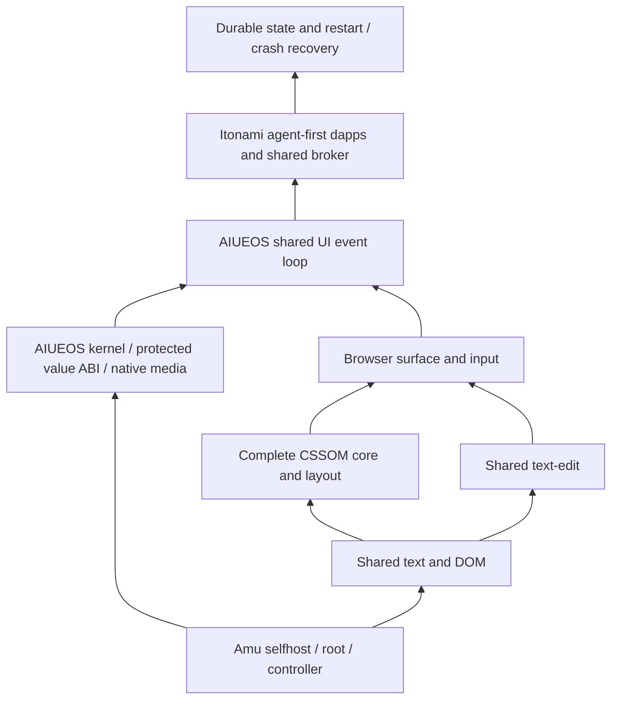

# Shared Browser native integration

JUN-93 proceeds from the compiler and shared components through the complete
kernel UI graph, then Itonami dapps and state restoration. The machine-readable
record is `os/aiueos/qualification/native-shared-browser-20261025.json`.

The source-pinned native component jobs in
[Amu run40165507318](https://github.com/kotoba-lang/amu/actions/runs/40165507318)
execute actual canonical text, DOM and text-edit modules on native ARM and x86
Linux. Their Kotoba verdicts are zero. Text/facade has32 golden assertions,
DOM retains nine native exports, and text-edit retains all13 reducer operations,
including Japanese/emoji caret/selection/delete and IME composition. The x86
project additionally executes multi-hop imports, schemas, callbacks and
library-only keyword output, with six compiler refusal controls. These are
bounded component proofs, not the full hosted parity suite.

The first candidate's actual x86 DOM trap exposed missing keyword-table
linkage. The corrected adapter converts canonical table positions to byte
units and tail-jumps library tables to the final root union. The all47 compiler
retains all18 normal adopted core modules and the adopted core image. The
combined private-store/sleep-resume source now regenerates the full47 root,
public compiler, controller and gate pins. The complete local ARM main-tier
passes with 95 production-source bindings to candidate `979049caf96a`.
The exact-head shared component jobs also pass on both native ISAs.
Full compiler/controller/public CI now passes for the exact head of
[Amu #1565](https://github.com/kotoba-lang/amu/pull/1565), merged at
`33d23f4c1abb85663bedf066a9e607e9127c9776`. Independent readback binds190 source
records, the x86 three-generation fixed point,24 cases/18 refusals, parent-death
cleanup,3 public aliases and90 lock-boundary observations. All41 changed
files match actual remote main. These gates do not qualify the complete
shared CSSOM/kernel UI/dapps/restoration scope below.

The bounded source-owner changes are merged in [Browser #36](https://github.com/kotoba-lang/browser/pull/36),
[DOM #10](https://github.com/kotoba-lang/dom-gpu/pull/10) and
[Kotoba #838](https://github.com/kotoba-lang/kotoba/pull/838).
The merged Browser and DOM main revisions also passed their own native ARM/x86
workflows: [Browser run40162008901](https://github.com/kotoba-lang/browser/actions/runs/40162008901)
and [DOM run40162030605](https://github.com/kotoba-lang/dom-gpu/actions/runs/40162030605).
Source locks and native verdicts were independently bound to those merged main bytes.
Both owners now have a native-only workflow; the removed JVM matrix is not restored.
The text owner is `kotoba/lib/kotoba.text`; its former repository is archived.
Native qualification must use the canonical owner and immutable source locks.

The retained complete CSSOM candidates still require typed calc AST/pair and
collection contracts. Layout has67 regex occurrences across39 patterns with
capture/split/replace/lookaround semantics that the group-free matcher cannot
silently replace. Native float/document support and every original suite
remain required. Review of the unadopted f64 compiler also found that shared
admission allowed x86 floating SIR into integer-only AArch64/Wasm emitters;
two emitted modules trapped in Chrome. The explicit backend refusal guard
now passes a native whole48 unit and all22 unchanged-source float refusals
across AArch64/Wasm, with integer42 still executing on ARM and Chrome. The
unadopted full48 candidate still requires latest-main reconciliation and all
compiler/runtime/floating caller-state gates; the existing refusal cases were
retained.
These are JUN-134/135/136/137 dependencies, not closed floors.

The native full30 diagnostic desktop is separately reproduced with the current
combined full47 ARM compiler. Its regenerated kernel/EFI/font/media bytes exactly match the images
used by the fresh seven-operation Mac QEMU run; that byte binding does not
claim QEMU was rerun for the new compiler root.
Seven real keyboard/mouse/redraw milestones pass, with private CR3/domain73 and
an unchanged snapshot medium. The receipt explicitly sets BrowserCSSOMParity
and dappsExecuted false: it still uses Browser-frame2 and unregistered cards.
Itonami is the agent-first workspace in this design; a card carrying its name
does not execute its dapps or connect a Murakumo node.

The 2026-10-25 local native desktop candidate adds an Itonami goal draft to
that diagnostic card. A locked 30-module kernel, EFI, font and media reproduced;
the Mac QEMU TCG check booted the AIUEOS kernel directly with no Linux guest or
NIC. PS/2 input opened Itonami, entered `ab`, then Backspace restored `a` in
the surface and the rendered screenshot. This verifies a bounded RAM-only GUI
interaction, not the Itonami agent loop, operation broker, durable workspace,
or complete Browser/CSSOM graph. The build compiler itself ran in a Linux
container; that is a build toolchain property, not a guest runtime dependency.
The source-bound local receipt and screenshots are in
[`native-itonami-goal-20261025`](evidence/native-itonami-goal-20261025/README.md).

The protected value runtime and complete surface/input graph are both
prerequisites of the shared UI event loop. The existing kernel's bounded ABI
does not yet supply the complete string/document/f64 runtime needed by CSSOM.
Keep its context, memory and floating-state contracts explicit before wiring
actual app operations. Use the canonical client-runtime broker
and fresh operation-specific consent. Durable restart/crash restoration must
be tested against real committed state after the dapp path works. Old packed
window-selection values and historical two-record backup tests do not supply
that proof. Hardware/release acceptance and the historical scorecard remain
separate; no product completion percentage is derived from these component jobs.

The canonical broker source is present in `kotoba-lang/wasm-webcomponent`
`origin/main` at `e00ae75e1c589f76b4f53a88a5e3256c98c9e162`:
`src/kotoba-client-runtime.js` has SHA-256
`7f760128c3a58098123c31ec3dd34b9c871932e3933f2c952facc4ab0e647212`.
The earlier local checkout was detached before that merge; its missing file
was not an owner-source blocker. The broker is JavaScript for the browser
host. Its existence does not mean the native AIUEOS desktop imports it or
provides trusted per-operation consent.

The current `itonami-agent` CLI entry imports Node host APIs
(`node:readline`, `node:crypto`) and its KBB/JS host adapters; that
implementation is not an AIUEOS native app artifact. The default native
diagnostic desktop retains a RAM-only goal draft. AWAI-90 adds an opt-in
[local draft commit/cold-restore probe](native-workspace-restore-progress.md),
with actual native disk I/O and refusal receipts. Its unsigned draft record
does not implement the D2 image codec or restore a registered workspace.
The next native integration gate is the complete shared
Browser/CSSOM runtime plus an Itonami target artifact with declared operations,
then a real agent turn, committed state and restart recovery on AIUEOS.
No product-local consent implementation is used.

The build host is a separate gate. The public Amu `bin/amu` is currently a
static Linux x86_64 ELF, and AIUEOS `build-native-kernel.py` explicitly
admits only matching Linux ELF compilers. `aarch64-macos` in Amu is a payload
target, not a runnable Mac selfhost compiler. The previous Mac QEMU proof
used a Linux container for compilation, so it proves a Linux-free guest,
not a Linux-free build/release chain. A native Mac (or AIUEOS-hosted)
self-rebuilding compiler and corresponding controller/runtime qualification
must replace that host dependency before this goal's build closure passes.
