<p align="center">
  
</p>

# aiueos

**An operating system.** Same category as Linux, Windows and macOS: it owns
firmware handoff, page tables, interrupts, scheduling, address spaces,
syscalls and device drivers, and it boots on real hardware architecture from
a signed image it builds itself. It is written in Kotoba, and the code that
makes decisions is compiled from Kotoba source rather than hand-written in C.

**It does not decide who may do what.** That moved to
[`kotoba-lang/grant`](https://github.com/kotoba-lang/grant) on 2026-08-21
(root ADR-2608219500). Aiueos asks; grant answers; aiueos enforces the answer.
Before that split this repository named an authority and a machine at once,
and the two were nearly the same size.

## AIUEOS and Itonami OS

**AIUEOS is the common OS foundation. Itonami OS is its Awai Network distribution.**
Both are maintained in this repository and use the same kernel, drivers, ABI
and native build pipeline. Awai-specific branding and composition belong to
the [`awai` distribution](distributions/README.md), while reusable OS changes
belong to the common AIUEOS core.

Kotoba is the language/tooling ecosystem; Amu compiles it and Kototama defines
execution contracts. `network-awai` composes and operates the distributed
network, services and Itonami OS product configuration. An Awai Node can also run
on other qualified hosts. Selecting Itonami OS does not enroll a node, grant
authority or qualify a component. Current installer/runtime evidence retains
its original scope; existing NixOS previews are not renamed AIUEOS releases.

See the [distribution decision](90-docs/adr/0274-awai-os-is-an-aiueos-distribution.md).

## Lisp machine architecture

AiueOS is the OS for a modern Kotoba Lisp machine in development. Kototama
is its implementation-independent Lisp VM contract: closed S-expression
computation, IPLD state, bounded authority and content-addressed receipts.
Amu checks and compiles code; grant decides permission; runtime hosts and OS
mechanisms enforce the admitted boundary. Kototama also has hosted engines
and does not require AiueOS for every execution.

The [stack architecture](https://github.com/kotoba-lang/kotoba-lang/blob/main/docs/stack-architecture.md) separates responsibility, source/library
and artifact dependencies. Its [composition contract](https://github.com/kotoba-lang/kotoba-lang/blob/main/lang/stack-architecture.edn) routes
to each owner's specification; it is not a new language or runtime semantics.
"Modern Lisp machine" describes the architectural direction. It does not
certify a complete integrated debugger, live system modification, full heap
image restore, selfhost compiler or physical-machine qualification.

## Where it actually is

An operating system is a claim with a lot of surface, so here is the measured
state rather than the ambition. The production profile is **C-free bare
metal**: the loader and kernel are compiler-emitted, and an effect counts as
native only when its artifact receipt has empty `c_sources`,
`foreign_objects`, `imports` and `dynamic_dependencies` (ADR-0013).

| | Status |
|---|---|
| Firmware to ring-0 Kotoba | **working** — compiler-emitted PE32+ `BOOTX64.EFI` and ELF64 `KERNEL.ELF`, bounded segment admission, final UEFI memory map, `ExitBootServices`, CR3 and port-I/O evidence |
| CPU and memory | **partial** — a bounded six-page C-free slice: Kotoba-derived physical allocator, a 512-entry first-GiB identity map loaded into CR3, W^X and guard pages, a Kotoba-built vector-14 IDT and real CPU fault receipts (ADR-0039/0040). A general allocator, dynamic mapping, ACPI, APIC, IRQ dispatch and SMP are not C-free yet |
| Kernel execution | **not yet** — context switch, preemptive scheduler, ring 3, syscall entry/exit, capability handle table all still reference-profile only |
| Hardware | **not yet** — PCI, DMA, IOMMU, MSI-X, virtio, NVMe, USB HID are reference C with QEMU evidence, not compiler-emitted |
| Boot and release | **working** — deterministic GPT disk and El Torito ISO from one builder, byte-identical recovery ESP with proven firmware fallback, update and rollback receipts, RSA-2048 release-signature verification, durable crash receipts, initramfs, Multiboot2/GRUB |
| Desktop | **partial** — the browser surface is the guest desktop on KERNEL.ELF: Kotoba writes kotoba-lang/browser's retained draw list and reduces a real virtio-tablet press to focus-and-raise (`guest-browser-frame` / `guest-browser-input`, ADR-0223), and draws window titles and bodies in Japanese and ASCII from a Unifont subset carried in the initramfs (`guest-browser-text` / `guest-browser-text-raised`, ADR-0224), and takes typing: a real virtio-keyboard through a Kotoba IME that mirrors the hosted `aiueos.compositor.ime` into the focused window (`guest-browser-type`, ADR-0225). hosted WM (ADR-0085) stacks two `window-session-state` surfaces in the same DADS `#desktop`; raise changes z-order; `kbb -M:compositor wm`. Guest 2D create/flush is `kbb -M:compositor gpu` (ADR-0084). hosted IME romaji→kana is `kbb -M:compositor ime` (ADR-0086). hosted kanji (Space converts か→加) is `kbb -M:compositor kanji` (ADR-0088). hosted kami.webgpu presenter (`init!`/`draw!` on `#kami-viewport`) is `kbb -M:compositor kami` (ADR-0089). Guest IME is KERNEL.ELF Kotoba `k`+`a`→U+304B (`kbb --backend sci --classpath src scripts/compositor-guest.cljk guest-ime`, ADR-0090). Guest WM is KERNEL.ELF Kotoba z-hit of two overlapping boot rects (`kbb --backend sci --classpath src scripts/compositor-guest.cljk guest-wm`, ADR-0091). Guest paint is KERNEL.ELF filling those rects in z-order (`kbb --backend sci --classpath src scripts/compositor-guest.cljk guest-paint`, ADR-0092). Guest input is KERNEL.ELF consuming a virtio-keyboard used-ring event (`kbb --backend sci --classpath src scripts/compositor-guest.cljk guest-input`, ADR-0093). Guest gpu-two is KERNEL.ELF creating two virtio-gpu 2D resources when Kotoba admits n=2 (`kbb --backend sci --classpath src scripts/compositor-guest.cljk guest-gpu-two`, ADR-0094). Guest scanout-two is KERNEL.ELF binding scanout 1 to resource 2 (`kbb --backend sci --classpath src scripts/compositor-guest.cljk guest-scanout-two`, ADR-0095). Guest broker is KERNEL.ELF Kotoba clipboard admit / picker refuse (`kbb --backend sci --classpath src scripts/compositor-guest.cljk guest-broker`, ADR-0096). Guest session restore is KERNEL.ELF Kotoba packed front 2 (`kbb --backend sci --classpath src scripts/compositor-guest.cljk guest-session`, ADR-0098). Leftover `:native-compositor-absent` (native component runtime, P5). **P5 UNVERIFIED**. Not a finished Chrome OS-shaped desktop |
| Content addressing | **partial** — `cid-v1-admit` decides that a block is the content a binary CIDv1 names, reading version, codec, multihash and digest length rather than taking a caller's 32 bytes on trust; `unixfs-file-admit` decides a canonical UnixFS file root, so an artifact larger than the 12,288-byte SHA-256 bound is verified block by block against one name (ADR-0128). Both are checked by verifiers that EXECUTE them against their contracts — the first here that do, since kotoba-kir gained an optional memory image. **Neither is linked into `KERNEL.ELF` yet** (amu's kotoba-native pin), so no boot has run either, and the OTA and model-channel paths still verify by manifest digest |
| Bare-metal net (P2) | **green on QEMU UEFI** — guest TLS 1.3 + HTTPS GET of empty raw CID with SHA-256 admit (ADR-0082). CertificateVerify ECDSA P-256 is `kbb -M:bare-metal cert-verify` (ADR-0087). Hosted `cloud-live` / session smoke / host curl do not count. Chain-to-anchor still leftover |

**Every gate above except P5's claim is QEMU/OVMF.** P5 real-machine boot is
**UNVERIFIED** (ADR-0084): this Mac is the QEMU host; attached USB is an
Ubuntu installer + data volume, not an aiueos image; USB OVMF is forbidden
as P5 (root ADR-2608221625 / ADR-0019). QEMU ≠ P5. Parity with Linux,
Windows or macOS is not claimed.

## What it is not

- **Not a desktop, not a phone, not an embedded target.** The only ISA with a
  complete bare-metal kernel is x86-64. The AArch64 material under
  `os/aiueos/aarch64/` is a bare-metal **bootstrap** (UEFI loader + freestanding
  kernel with a self-built `TTBR0_EL1` and enforced W^X, ADR-2608080600 tracks
  a1/a2) — it does not yet reach a userspace or full kernel, so it is not a
  second port. The AArch64 artifacts under `resources/hvt/` are
  hypervisor-guest spikes. There is no Android, iOS,
  Raspberry Pi or IoT profile, and nothing here claims one.
- **Not POSIX.** The first syscall ABI is capability-handle based. POSIX is an
  optional service, not the kernel authority (ADR-0013).
- **Not the authority.** `grant` decides admission, policy, signing, surfaces
  and profiles. What is here is the machine that carries out the decision --
  and the last place that could ignore it, which is why so much of it is still
  in the TCB inventory.

## The C boundary, stated as it is

`os/aiueos/kernel/` carries about 7,000 lines of C and assembly. That is not a
crt0 shim; it is a real mechanism kernel, and ADR-0015 says so rather than
repeating the older "minimal entry shim" story.

The reviewable property is **decision-free C**: C and assembly own registers,
MMIO, GDT/IDT, paging primitives, APIC/SMP bring-up, virtqueue plumbing and
context switch. Every *decision* -- SHA-256 and RSA-2048 verification,
ELF/catalog/journal admission, capability encode/admit/derive/revoke planning,
scheduler dispatch planning, pointer/length window admission, syscall-range
validation -- is compiler-emitted Kotoba. The C substrate contains no digest,
signature, admission or capability logic.

That reference kernel is an oracle and a porting specification. It is **not**
cumulative evidence that the C-free kernel implements the same mechanism;
only the C-free ledger in ADR-0013 is.

## Runtime dependencies

No Rust: the runtime crate and `bin/aiueos.rs` were retired and reimplemented
in CLJC, and `safe.rs` was dropped as redundant. There are zero `.rs` files
here.

No JVM **in what boots**: the C-free rule forbids libc, a CRT, a JVM, Linux
and any hosted supervisor in the bare-metal profile, and the artifact receipt
is what enforces it.

A JVM **in the hosted profiles and in the toolchain**: `aiueos.execute` hosts
compiled Kotoba Wasm through Chicory and is JVM-only, as is
`aiueos.launcher`. Fuel metering rides Chicory's `withUnsafeExecutionListener`
-- documented unsafe, experimental, interpreter-path-only -- so treat it as a
working prototype on an unofficial API rather than a guarantee. Memory limits
use a stable API.

## Position in the stack

```text
kotoba semantics -> amu -> kotoba-native freestanding ABI -> aiueos boot images
                                                     grant -> aiueos (decides)
                                                     aiueos -> kototama (executes)
```

`kototama` executes Components and placement (`sahai` at T6, `murakumo` for
its inference fleet) decides where they run. Aiueos
supplies the named providers and the machine underneath them; it does not own
another system's compiler or fleet scheduler, and since the split it does not
own the grant vocabulary either.

## Native dependency and evidence boundary

The production dependency is deliberately one-way:

```text
Kotoba semantics
  -> kotoba-native instruction selection and freestanding ABI
  -> Amu compiler/package emission and qualification
  -> aiueos loader, kernel, effects, and machine evidence
```

`kotoba-native` does not own an OS provider, Amu does not own process or
hardware isolation, and aiueos does not redefine language or instruction
semantics. An effect is production-native only when the same exact-pinned
chain reaches the compiler-emitted `BOOTX64.EFI` and `KERNEL.ELF`, carries an
empty foreign-code receipt, and passes positive plus fail-closed QEMU evidence.
Hosted `aiueos.vm`, experimental `aiueos.hvt`, and the older C/assembly kernel
are useful oracles, but none qualify the C-free bare-metal profile.

The ownership decision and gap ledger are
[`ADR-0013`](90-docs/adr/0013-native-os-ownership-and-boot.md); the current
C-free W^X/guard and CPU-fault evidence is
[`ADR-0039`](90-docs/adr/0039-c-free-page-fault-hardware-receipts.md), with
bounded recovery in
[`ADR-0040`](90-docs/adr/0040-c-free-recoverable-page-fault-frame.md). Amu
records the consumer/compiler boundary in ADR-0240; the root handoff is
ADR-2608110400.

## Reference stack topology and C mechanism boundary

aiueos is the stack's **capability broker**: dependency-minimal by invariant
(deps.edn carries `security` + Chicory only; enforcement layers like
`kototama` import aiueos, never the reverse), consuming the Kotoba compiler
as **verified artifacts** (freestanding ELF objects), not as a library. The
historical bare-metal split — C/asm owns mechanism only, every decision (crypto
verification, admission, capability planning, dispatch planning) is
compiler-emitted Kotoba — is stated honestly, with measured line counts, in
[`90-docs/adr/0015-stack-topology-and-honest-c-boundary.md`](90-docs/adr/0015-stack-topology-and-honest-c-boundary.md)
(root authority: `com-junkawasaki/root` ADR-2607241100).

## What is here

The decision namespaces that used to be listed under this heading moved to
[`kotoba-lang/grant`](https://github.com/kotoba-lang/grant) on 2026-08-21 --
`contract`, `graph`, `policy`, `authority`, `surface`, `manifest`, `signing`,
`audit`, `broker`, `cli`, `decide` and fourteen more. They are reached here as
`grant.*` and pinned by git SHA in `deps.edn`; grant's README is where they are
documented now.

`aiueos.topic` stayed: the in-process pub/sub bus is a substrate, not a
decision. Which topics a component may publish to is decided in
`grant.manifest`; carrying the messages is this repository's job.

### Kotoba guests (ADR-0202)

Three namespaces now compile as pure Kotoba guests, the `.cljc` staying as
the parity oracle (ADR-0202): `aiueos/topic.kotoba` (the whole topic bus —
publish / latest / take-sample / pending / topic-count / tick / advance),
`aiueos/os_update.kotoba` (health-status, boot-selection, the non-regex
manifest faults) and `aiueos/model_channel.kotoba` (the four
sequence-history rules and the boot decision). All three compile
(`amu compile --target wasm32-browser`), none declares or calls a
capability: effect inference answers `:effects #{}` for a guest that only
moves immutable documents, and the pure-product profile would reject a
capabilities declaration outright. Measured bounds are stated in each
guest's header — `:container-items 32` (a 33rd queued sample traps
`document-vector-too-large`, fail-closed), `max-parameters 5` (booleans
travel as an i64 flags vector), no `rem`/`mod` lowering (spelled
`quot`-and-subtract). Regexes over wire bytes, publisher closures and the
clock stay in the host. The rule the ADR records: a pure guest is written
with zero capability lines; a guest that touches the world declares
exactly the capabilities it uses, through `perform`, and nothing else.

What is left here executes, boots and drives hardware.


- `src/aiueos/execute.cljk` **actually executes** a compiled `.kotoba` Wasm
  component (ADR-2607022900), via [Chicory](https://github.com/dylibso/chicory).
  Verifies through `grant.broker/verify-one` first and refuses to run anything
  denied; the 7 non-hardware kernel capabilities (`log-write`/`clock-monotonic`/
  `random-bytes`/`topic-*`) get real Clojure-backed host functions, the
  device-access quartet (`pci-config`/`dma-map`/`irq-subscribe`/`mmio-map`) stays
  a deterministic stub pending real hardware access (native shim or
  `java.lang.foreign`, unresolved). Enforces `:aiueos/quota {:host-calls N
  :publishes N}` (ADR-0006) — a per-run host-function call-count cap; exceeding
  it aborts the run mid-execution (`:aiueos.execute/quota-exceeded`, offending
  call's own effect never lands). Also enforces `:aiueos/limits :fuel`
  (ADR-0001) — **real instruction-level metering**, via Chicory's
  `Instance.Builder/withUnsafeExecutionListener` (fires per Wasm instruction
  executed). Chicory has no first-class gas-metering API, and this hook is
  explicitly documented `unsafe`/`experimental`/possibly removed later (its
  supported execution-limit mechanism is a wall-clock thread-interrupt timeout,
  not this) — treat fuel enforcement as a working prototype on an unofficial
  API, not a permanent guarantee. It also only fires in Chicory's interpreter
  path; a future switch to Chicory's AOT compiler would bypass it entirely.
  Also enforces `:aiueos/limits :memory-pages` (ADR-0001) — via a **stable**
  Chicory API (`Instance.Builder/withMemoryLimits`, not marked
  unsafe/experimental like the fuel listener). Reads the module's own declared
  initial page count (never overridden) and caps only the maximum
  `memory.grow` can reach; unlike quota/fuel/topic-forbidden, this does NOT
  abort the run — `memory.grow` past the cap returns Wasm's own `-1` failure
  sentinel to the guest. Also enforces `:aiueos/publishes`/`:aiueos/subscribes`
  (the topic-id allow-set `grant.manifest/normalize` derives) — a granted
  component's `topic_publish`/`topic_poll`/`topic_take`/`topic_count` calls are
  restricted to its declared topic ids (`nil` = unrestricted). Every result
  also carries an ADDITIVE `:aiueos/run-receipt` (`grant.broker/run-receipt`,
  ADR-2607022900 follow-up 8): `:succeeded`/`:failed`/`:denied` status,
  `:started-at`/`:finished-at` (epoch ms), and the same audit events.
  **JVM-only** — needs `kbb -M:test` (Chicory was never in babashka's class
  allowlist, and babashka has since been retired outright).
- `src/aiueos/launcher.cljk` is a real, runnable CLI: the retired Rust
  `bin/aiueos.rs`'s argv-parsing/file-I/O role, reimplemented as JVM Clojure.
  Ties `grant.cli` + `grant.manifest` + `grant.policy`/`grant.broker` +
  `aiueos.execute`/`aiueos.audit` together. `verify`/`run`/`admit`/`inspect`/
  `surface`/`audit`/`up` are wired today (`run`/`admit` actually execute a
  granted component's declared `:aiueos/wasm`, not just decide; `up` boots the
  components due at a given ADR-0006 cycle (`--cycle N`, default 0) in
  `grant.graph/priority-boot-order`, stopping at the first
  denied/quota-or-fuel-exceeded DUE component). Try it: `kbb -M -m
  aiueos.launcher up <system>.edn --cycle 3 --edn`. **`:aiueos/schedule`'s
  `:deadline-cycles` is NOT enforced** — see `grant.manifest/due-this-cycle?`'s
  docstring for why. **JVM-only**, same reason as `aiueos.execute`. Not wired:
  four adapter-only commands (`sign`/`check`/`compile`/`hash`). `image` and
  `vm` are wired for the experimental Linux-hosted PID-1 profile (ADR-0011).
- The contract EDN under `resources/aiueos/` moved to grant with the code that
  reads it. The keys did not change: `:aiueos.policy/*`, `:aiueos.broker/*` and
  `:aiueos/*` are on the wire, read by `kototama`'s adapter and by stored
  decisions, so only the namespaces were renamed. They still load from the
  same classpath paths, now shipped by the grant dependency.
- `test/aiueos/*_test.cljc` checks every CLJC validator/reasoner/contract above.

The one exception worth naming on the language side: the retired `safe.rs`
(safe-kotoba subset gate) was NOT ported because it's redundant — that check
already lives in `kotoba-lang/kotoba`'s `kototama`/`kotoba-clj` layer.

## Examples / deployment docs

- `examples/**/*.edn` and `examples/**/*.clj` — runnable manifests/policies
  across the robot, browser, computer-use, driver, and signed-component
  surfaces.
- `docs/deployment-profiles.md`, `docs/incident-exercises/`, `docs/issues/` —
  deployment-profile-specific security claims and IR drill writeups.
- `90-docs/adr/` — architecture decisions for the capability OS and its
  surfaces.

## Verify

```bash
kbb -M:test   # full suite, including aiueos.execute-test (Chicory, JVM-only)
./os/aiueos/scripts/smoke-qemu-journal-recovery.sh # no-Linux OVMF gate
```

`scripts/tasks.edn` additionally registers the boot/flash gates:
`multiboot-build`, `multiboot-smoke`, `grub-multiboot-smoke`, `usb-boot-smoke`,
`usb-flash` — run through `kbb --backend sci scripts/run-task.cljk <task>`.

**Two entrypoints this README used to document are unavailable.** babashka was
retired as this workspace's script host by ADR-2607173000, and both bodies were
babashka-hosted `(require …)` + `run-tests` / subprocess forms that the
conversion could not express, so they were dropped (ADR-2608131600). The
recovered forms are in `scripts/tasks-complex.edn`.

- **`kbb -M:test:cljc`** — the pure CLJC authority contract tests, i.e. everything
  except `aiueos.execute-test`. `kbb -M:test` above still runs those
  assertions; what is gone is the ability to run them *without* the JVM.
- **`kbb -M:decide`** — the decision subprocess described above. `aiueos.decide` and
  `grant.cli` are unchanged, so a host adapter can still reach the same
  contract, but there is no packaged task entrypoint for it today.

See `90-docs/adr/0013-native-os-ownership-and-boot.md` for the repository
boundary and `os/aiueos/README.md` for native build requirements.

## Linux-hosted VM bundle

The VM image needs a Linux JRE and its ELF loader/shared libraries; a macOS
`jlink` runtime cannot run in the guest. Build the cross-host bundle with:

```bash
scripts/build-linux-bundle.sh aarch64   # or x86_64
```

Then provide a matching Linux kernel and system graph:

```bash
AIUEOS_ARCH=aarch64 \
AIUEOS_KERNEL=/path/to/Linux/Image \
AIUEOS_SYSTEM=/path/to/system.aiueos.edn \
scripts/vm-smoke.sh
```

The smoke image embeds `/jre`, `/aiueos.jar`, the Linux dynamic loader/libs,
and an argfile-based `/init`. PID 1 prints `AIUEOS_BOOT_OK` after the component
graph starts and powers the disposable VM off. `image build` rejects missing
JRE/JAR/runtime-root inputs and rejects a non-ELF guest Java executable.

This is the ADR-0011 Linux-hosted profile, not the bare-metal kernel described
by the product integration ADR in `kotoba-lang/kotoba`.

## Hosted daily shell (P1)

Root contract: [`adr-2608221625-aiueos-chromeos-cloud-desktop`](https://github.com/com-junkawasaki/root/blob/main/90-docs/adr/2608221625-aiueos-chromeos-cloud-desktop.edn).
This is the JVM hosted profile. It is **not** the bare-metal compositor, and
`kbb -M:cloud-live check` does **not** green this gate.

```bash
kbb -M:session smoke
```

Expected markers:

- `AIUEOS_SESSION_URL=http://127.0.0.1:<port>/#session`
- `AIUEOS_SESSION_SPA=admitted`
- `AIUEOS_SESSION_KOTOBASE=` … `"outcome":"admitted"` on a real `kotobase.net` GET
- `AIUEOS_SESSION_INFER=` … `"alias":"murakumo-main"` and a completion snippet
- `AIUEOS_SESSION_OK`

The OS UI engine contract is `kotoba-lang/browser`; DADS is the component and
token layer inside that surface. The committed HTML/JavaScript document is a
hosted verification adapter and is explicitly not counted as the native
Kotoba-clj/WASM browser guest.

Exit 0 means the DADS SPA was served and both live legs were admitted **from
the session process**. Exit 1 is a refusal or a non-DADS document. Exit 3
means a leg could not be answered.

```bash
kbb -M:session serve   # open the printed URL on a phone-sized viewport
```

## Mac VM phone-bind (P1b / P1c proving slice)

Root contract: [`adr-2608221625-aiueos-chromeos-cloud-desktop`](https://github.com/com-junkawasaki/root/blob/main/90-docs/adr/2608221625-aiueos-chromeos-cloud-desktop.edn).
This slice does **not** claim a compositor, bare-metal TLS, itonami, or
real-machine qualification.

A VM has no chassis sticker. The hypervisor helper on the Mac prints the
setup URL and QR payload on the **host** terminal and writes `setup.json`
next to the VM. QEMU runs with `-display none`; guest VGA/keyboard is not a
passing path. User-mode/slirp stands in for Ethernet DHCP. The hosted fixture
uses `grant.enroll` (not a second identity stack). The
product account flow sends `Passkey` or `phone-scan` into one single-use
challenge at `https://auth.kotoba.cloud/v1/aiueos/device/start`; the helper polls
`/v1/aiueos/device/poll` with a separate node-only secret and then proves the
device-owned Ed25519 key. Start and poll are each signed by that key; the start
also binds a separate X25519 public key. The browser and locally rendered QR
receive only the public approval URL. They receive neither the poll secret,
device enrollment token, nor an account/passkey private key. The formal WebAuthn
authority and RP ID are both `auth.kotoba.cloud` (ADR-0113). An optional Wi-Fi
profile is encrypted in the authenticated phone browser directly to that X25519
key; the authority receives only an opaque AES-GCM envelope and AIUEOS persists
only that envelope after local decryption/validation. Native K16 radio
association is still pending its driver gate. The local check-in ledger is labelled
`non-authoritative`; production still names `https://kotobase.net`. A mocked
authority gate proves the adapter and binding rules; a production deployment
plus a human Passkey ceremony remains separate live evidence.

The device-owned Ed25519 seed can also mint a five-minute CACAO whose issuer is
the node's own `did:key`, for Murakumo heartbeat and inference-queue
capabilities. This is hosted cryptographic evidence; the physical K16 still
uses its Mac UDP relay, so it is not yet evidence of K16-direct HTTPS/CACAO.

On Apple Silicon this uses `qemu-system-aarch64` + HVF + edk2 firmware, the
same ISA `aiueos.vm` defaults to. It is **not** the x86_64 C-free kernel
gate.

```bash
# from this repository (worktree or clone)
kbb -M:phone-bind smoke
```

Expected markers on stdout:

- `AIUEOS_SETUP_URL=http://127.0.0.1:<port>/#setup`
- `AIUEOS_QR=aiueos:2;did=...;model=aiueos-qemu-hosted;endpoint=...;auth=passkey,phone-scan;claim-secret=none`
- `AIUEOS_BIND_OK`

Exit 0 means an unbound headless VM was bound by a simulated **phone HTTP**
client (no guest keyboard), a bind receipt was written, and a QMP power
cycle left the device claimed. Exit 1 is a refusal. Exit 3 means QEMU or
firmware could not be answered (not a pass).

```bash
kbb -M:phone-bind pre-enroll   # P1c: grant in the image, zero QR, copy refused
kbb -M:phone-bind serve        # leave the phone SPA up; open the printed URL
```

The SPA is the DADS document at `apps/session` (fragments `#session` `#desktop` `#setup`
`#manage` `#devices`). Phone-bind serves that one HTML. `kbb -M:session smoke`
is P1 (kotobase + murakumo from the session process). `kbb -M:test` of
unrelated suites is **not** this gate.

The complete onboarding boundary is
`os/aiueos/contracts/device-onboarding-v1.edn`. Account sync, Murakumo
readiness, Kekkai reachability, and Kotobase/CARv2 storage replication are
independent gates. The current contract neither authorizes an internal SSD
write nor claims that the native Kekkai or storage adapter already exists.

## Desktop / compositor (hosted WM + guest 2D argv + kami.webgpu presenter)

Root contract: compositor unit of [`adr-2608221625`](https://github.com/com-junkawasaki/root/blob/main/90-docs/adr/2608221625-aiueos-chromeos-cloud-desktop.edn). HTTP to `#session` with `-display none` and no compositor process is **red**. QMP `query-pci` is **not** guest 2D. A single notes iframe is **not** a window manager.

The same `apps/session` DADS SPA is the shell. A compositor process owns `window-session-state` surfaces, persists them in `state/desktop.edn`, and restores after kill/relaunch. A wiped file is refused (`empty-desktop`), not an empty success. Hosted WM (ADR-0085) stacks two overlapping surfaces with DADS title bars; `raise` changes z-order; pointer hit-test is front-to-back. QEMU for `smoke` is started with `-device virtio-gpu-pci` and still `-display none` so P1b phone bind needs no local keyboard.

```bash
kbb -M:compositor smoke   # hosted SPA + surfaces + PCI listing
kbb -M:compositor gpu     # KERNEL.ELF CREATE+FLUSH (not PCI listing)
kbb -M:compositor wm      # hosted WM: ≥2 surfaces, z-order, DADS, input routing
kbb -M:compositor ime     # hosted IME: ka→か, off-path latin leak is red
kbb -M:compositor kanji   # hosted IME: Space converts か→加; kana-only Space is red
kbb -M:compositor kami    # hosted kami.webgpu init!/draw!; sky-clear is red
kbb --backend sci --classpath src scripts/compositor-guest.cljk guest-ime  # KERNEL.ELF Kotoba k+a→U+304B
kbb --backend sci --classpath src scripts/compositor-guest.cljk guest-wm   # KERNEL.ELF Kotoba z-hit of two overlapping rects
kbb --backend sci --classpath src scripts/compositor-guest.cljk guest-paint # KERNEL.ELF paints both rects in Kotoba z-order
kbb --backend sci --classpath src scripts/compositor-guest.cljk guest-input # KERNEL.ELF consumes a virtio-keyboard used-ring event
kbb --backend sci --classpath src scripts/compositor-guest.cljk guest-gpu-two # KERNEL.ELF two virtio-gpu 2D resources when Kotoba n=2
kbb --backend sci --classpath src scripts/compositor-guest.cljk guest-scanout-two # KERNEL.ELF scanout 1 → resource 2 when Kotoba n=2
kbb --backend sci --classpath src scripts/compositor-guest.cljk guest-broker # KERNEL.ELF Kotoba clipboard-only broker admit
kbb --backend sci --classpath src scripts/compositor-guest.cljk guest-session # KERNEL.ELF packed front 2 restore
```

Expected `smoke` markers:

- `AIUEOS_COMPOSITOR_URL=http://127.0.0.1:<port>/#desktop`
- `AIUEOS_COMPOSITOR_SPA=admitted`
- `AIUEOS_COMPOSITOR_SURFACES=admitted`
- `AIUEOS_COMPOSITOR_RESTORE=admitted`
- `AIUEOS_COMPOSITOR_WIPE=refused-as-required`
- `AIUEOS_COMPOSITOR_DISPLAY=none`
- `AIUEOS_COMPOSITOR_GPU=virtio-gpu-pci`
- `AIUEOS_COMPOSITOR_OK`

`smoke` exit 0 means the SPA was served, surfaces restored, wipe is red, and QMP `query-pci` named virtio-gpu. That is **not** 2D.

`gpu` exit 0 means guest serial has `AIUEOS_VIRTIO_GPU_CREATE result=ok` and `AIUEOS_VIRTIO_GPU_FLUSH result=ok` (ADR-0084). GET_DISPLAY_INFO without those lines is leftover `:gpu-2d-create-flush-absent`. Exit 1 is a refusal. Exit 3 means QEMU/firmware/serial could not be answered.

`wm` exit 0 means two surfaces stack, one-surface is red, raise changes the front, overlap hit ≠ map key order, DADS title bars are in the SPA, and pointer routing names the focused guest (ADR-0085). IME is not required for `wm`.

`ime` exit 0 means IME-on consumes `ka` (no latin to the guest), Enter commits `か`, and IME-off delivers `ka` (ADR-0086 named red). Hosted leftover after guest IME is `:native-compositor-absent`.

`kanji` exit 0 means Space converts `か` to `加` without delivering to the guest, Enter commits `加`, and Space that commits kana is red (`kana-only-desktop`, ADR-0088). That is **not** a finished desktop.

`kami` exit 0 means the SPA calls `kami.webgpu/init!` then `draw!` on `#kami-viewport` with a `render-ir` of ≥1 instance (ADR-0089). A sky-only `beginRenderPass` clear is leftover `:clear-only-desktop`. Exit 3 means the browser could not be answered. Native compositor leftover remains. That is **not** a finished desktop.

`guest-ime` exit 0 means KERNEL.ELF serial has `AIUEOS_GUEST_IME_OK committed=u+304b latin-leak=0` from Kotoba `kotoba_aiueos_ime_commit` (ADR-0090). Hosted `kbb -M:compositor ime` / `AIUEOS_COMPOSITOR_IME_OK` is red. virtio-input is still synthetic. Leftover `:native-compositor-absent`. That is **not** a finished desktop.

`guest-wm` exit 0 means KERNEL.ELF serial has `AIUEOS_GUEST_WM_OK two-surfaces z-hit=2 miss-front=1 raise=1 one-surface=0` from Kotoba `kotoba_aiueos_wm_hit` (ADR-0091). Hosted `kbb -M:compositor wm` / `AIUEOS_COMPOSITOR_WM_OK` is red. virtio-input synthetic remains. Leftover `:native-compositor-absent`. That is **not** a finished desktop.

`guest-paint` exit 0 means KERNEL.ELF serial has `AIUEOS_GUEST_PAINT_OK boot-overlap=2 raised-overlap=1 key-order=0` from painting both boot rects in Kotoba z-order and sampling the overlap pixel (ADR-0092). Hosted `kbb -M:compositor wm` is red. A key-order paint is leftover `:key-order-paint`. Default gpu/guest-paint boots still use synthetic input. Leftover `:native-compositor-absent`. That is **not** a finished desktop.

`guest-input` exit 0 means KERNEL.ELF serial has `AIUEOS_GUEST_INPUT_OK eventq-used=1 synthetic=0` from a virtio-keyboard used-ring event (ADR-0093). Hosted `kbb -M:compositor wm` is red. C filling keycode 30 is leftover `:synthetic-smoke`. HMP `sendkey` is not this gate. QMP inject is not a laptop HID and not P5. Leftover `:native-compositor-absent` (permission broker, native component runtime, one virtio-gpu scanout). That is **not** a finished desktop.

`guest-gpu-two` exit 0 means KERNEL.ELF serial has `AIUEOS_GUEST_GPU_TWO_OK resources=2 flush=2 kotoba-n=2` from Kotoba-admitted count and two CREATE/FLUSH paths (ADR-0094). Hosted `kbb -M:compositor wm` is red. C hardcoding resource count is leftover `:one-resource`. Leftover `:native-compositor-absent`. That is **not** a finished desktop.

`guest-scanout-two` exit 0 means KERNEL.ELF serial has `AIUEOS_GUEST_SCANOUT_TWO_OK scanouts=2 resource-0=1 resource-1=2 kotoba-n=2` from Kotoba-admitted bind count and SET_SCANOUT on scanout 1 (ADR-0095). Hosted `kbb -M:compositor wm` is red. One scanout when Kotoba admits two is leftover `:one-scanout`. Leftover `:native-compositor-absent`. That is **not** a finished desktop.

`guest-broker` exit 0 means KERNEL.ELF serial has `AIUEOS_GUEST_BROKER_OK clipboard=1 picker=0 kotoba-clip=1 kotoba-pick=0` from Kotoba `kotoba_aiueos_broker_admit` (ADR-0096). Hosted `kbb -M:compositor wm` is red. Picker admitted on a clipboard-only grant is leftover `:always-grant`. Leftover `:native-compositor-absent`. That is **not** a finished desktop.

`guest-session` exit 0 means KERNEL.ELF serial has `AIUEOS_GUEST_SESSION_OK restored-front=2 packed=2 kotoba-front=2 hit=2` from Kotoba `kotoba_aiueos_session_restore` (ADR-0098). Hosted `kbb -M:compositor wm` is red. Restore that always returns 2 is leftover `:always-front`. Leftover `:native-compositor-absent` (native component runtime, P5). That is **not** a finished desktop.

`guest-browser-frame` exit 0 means KERNEL.ELF serial has `AIUEOS_GUEST_BROWSER_FRAME_OK ops=5 overlap=d8e7ff win1-title=dde2ea surface=WxH`: Kotoba `kotoba_aiueos_browser_frame` wrote kotoba-lang/browser's retained draw list (workspace, body + titlebar per window in `:surface/windows` order, browser.surface's colours) and C presented it in list order (ADR-0223, under browser ADR 0002). A key-order paint is leftover `:key-order-paint`. No text is drawn: leftover `:no-text-raster`. That is **not** kotoba-lang/browser compiled for the kernel and **not** a finished desktop.

`guest-browser-input` exit 0 means the same boot also has `AIUEOS_GUEST_BROWSER_INPUT_OK eventq-used=1 kind=pointer-down ... hit=1 front=1 overlap=ffffff`: a real virtio-tablet press (QMP, `AIUEOS_GUEST_BROWSER=1`) scaled by C to surface pixels, reduced by Kotoba `kotoba_aiueos_browser_reduce` (browser.input's topmost hit + browser.surface's focus-and-raise), and the redrawn frame shows window 1 in front. A tablet that delivers nothing is leftover `:no-pointer-event`; a raise the frame does not show is `:raise-not-painted`. Drag/resize capture and text editing are leftover `:no-pointer-capture` / `:no-text-edit`. QMP inject is not a laptop HID and not P5.

`guest-browser-text` exit 0 means KERNEL.ELF serial has `AIUEOS_GUEST_BROWSER_TEXT_OK ops=70 text-px=1079 hash=89910f34 ... surface=1280x800`: Kotoba `kotoba_aiueos_browser_frame2` laid out rects AND glyphs in one list, window by window in stack order, against `os/aiueos/fonts/aiueos-16.fnt` (GNU Unifont `unifont_jp` subset, SIL OFL 1.1, the fourth initramfs entry), and the count and FNV-1a of every #111111 pixel equal a model of the same frame written apart from Kotoba and C (ADR-0224). `guest-browser-text-raised` adds a real tablet press and the re-laid frame (`text-px=880 hash=b9f96599`: window 2's text fully covered). Since ADR-0234 each body is laid out as browser.surface + cssom lay it out (`guest-browser-flow-parity`); no editing here: leftover `:no-text-edit`. The frame is on the QEMU display, not only in memory: the GOP framebuffer is the backing of virtio-gpu scanout 0 (`AIUEOS_GUEST_BROWSER_SCANOUT_OK`), and the tablet profile screendumps both frames:

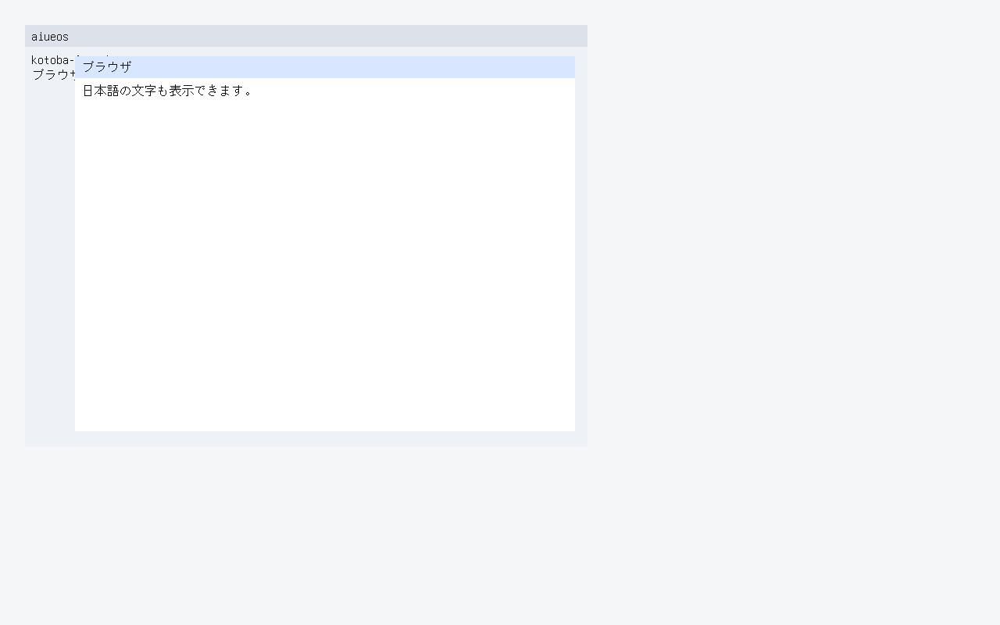

`guest-browser-text-raised` exit 0 means the tablet boot (`AIUEOS_GUEST_BROWSER=1`) also has `AIUEOS_GUEST_BROWSER_TEXT_RAISED_OK hit=1 ops=70 text-px=880 hash=b9f96599`: the press raised window 1 through Kotoba `kotoba_aiueos_browser_reduce`, `kotoba_aiueos_browser_frame2` re-laid rects and glyphs in the new stack order, and window 2's text is fully covered -- the census equals the model (ADR-0224).

`guest-browser-type` exit 0 means the same tablet boot then took `n i h o n n g o Enter k a Space Enter` from the host's virtio-keyboard, every press through Kotoba `kotoba_aiueos_browser_key` (the hosted IME's `handle-key` rules, its romaji table generated by `os/aiueos/scripts/gen-ime-mora.cljk`), committed にほんご加 into window 1's body, and the redrawn frame's census equals the model (`AIUEOS_GUEST_BROWSER_TYPE_OK presses=13 committed=5 ops=75 text-px=1068 hash=a92b8f58`, ADR-0225). The preedit is not drawn and the dictionary is the oracle's three readings.

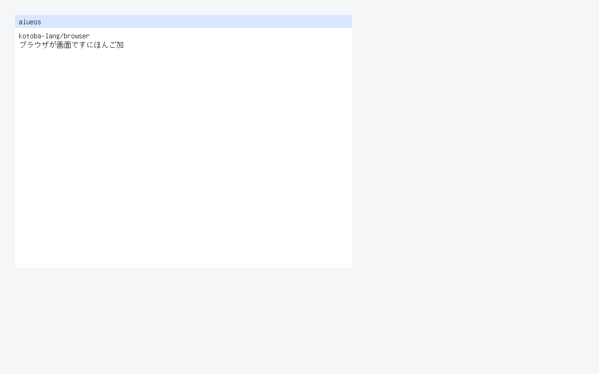

`guest-browser-preedit` exit 0 means the same boot then took `k a n`: the IME held か as preedit and `n` as romaji, Kotoba `kotoba_aiueos_browser_frame2` drew both underlined after window 1's body, and after Enter committed かん the frame had no rule -- both censuses equal `os/aiueos/scripts/browser-frame-model.cljk`, a model that reproduces the three earlier frames (`AIUEOS_GUEST_BROWSER_PREEDIT_OK shown-ops=67 shown-px=1146 ... committed=2 ops=77 text-px=1128 hash=193030b3`, ADR-0227; the numbers include the caret since ADR-0232).

`guest-browser-drag` exit 0 means the same boot, after the IME toggle, took a virtio-tablet press on window 1's titlebar at (60, 50), moves to (140, 90), (220, 120) and (300, 150), a release, and one more move to (380, 200), and Kotoba `kotoba_aiueos_browser_reduce` answered each as `browser-reduce-v1`'s oracle vectors do (1 1 1 1 0 0): the press captured a drag, every move put window 1 at the pointer minus the press offset (browser.input's `:drag` capture, browser.surface/move-window), the release cleared the capture, and the move after it moved nothing. Window 1 ended at (272, 132) -- moved by the pointer's (240, 100) -- and the frame matched os/aiueos/scripts/browser-frame-model.cljk exactly (serial `AIUEOS_GUEST_BROWSER_DRAG_OK events=6 answers=111100 from=32,32 to=272,132 capture=0 ops=80 text-px=1947 hash=523440e0`); the screendump `guest-browser-drag.ppm` counts the same 1,947 #111111 px (ADR-0229). It does not mean a resize handle does anything (`:no-resize-capture`), that a frame is drawn after each move (one frame after the gesture), or that a window can be dragged past the surface origin (refused, -6).

`guest-browser-resize` exit 0 means the same boot, after the drag, took a virtio-tablet press at (984, 664) inside window 1's 16 px resize handle, moves to (784, 564), (300, 200) and (504, 324), a release, and one more move to (900, 700), and Kotoba `kotoba_aiueos_browser_reduce` answered each as `browser-reduce-v1`'s oracle vectors do (1 1 1 1 0 0): the press captured a resize, every move set window 1's size to its size at the press plus the pointer's travel, never below 120 x 80 (browser.input's `:resize` capture, browser.surface/resize-window), the release cleared the capture, and the move after it changed nothing. After the second move window 1 was clamped at 120 x 80; it ended 240 x 200 at an unmoved (272, 132), its body kept its one line -- cssom has no break opportunity inside a CJK run, so since ADR-0234 the line overflows the narrower window as the hosted engine's does, and the census equals the drag's -- and the frame matched os/aiueos/scripts/browser-frame-model.cljk exactly (serial `AIUEOS_GUEST_BROWSER_RESIZE_OK events=6 answers=111100 clamp=120x80 size=240x200 at=272,132 capture=0 ops=80 text-px=1947 hash=523440e0`, ADR-0230); the screendump `guest-browser-resize.ppm` SCREENDUMP. It does not mean a frame is drawn per move (`:no-redraw-per-move`), or that any edge but the bottom-right handle resizes.

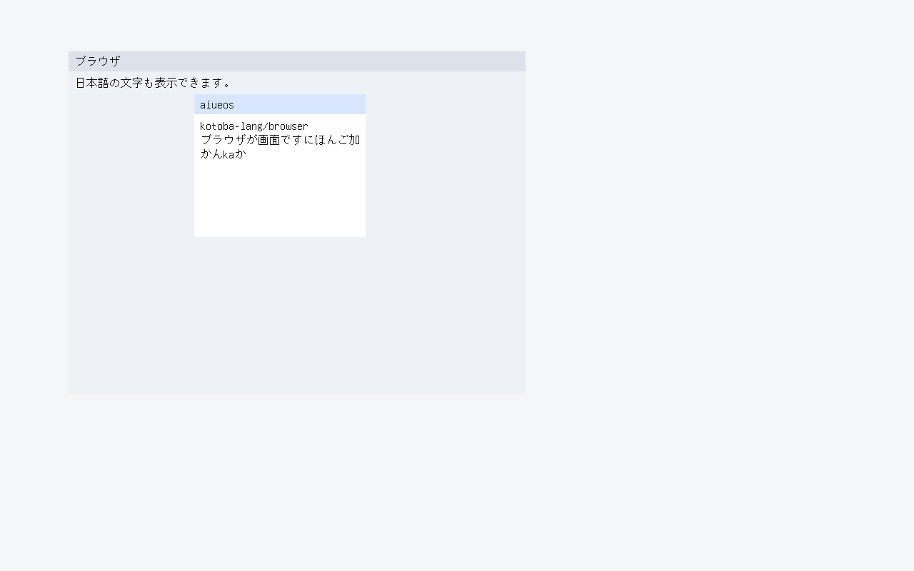

`guest-browser-event-loop` exit 0 means the same boot, after the resize, ran ONE loop that polled the virtio-tablet and the virtio-keyboard in turn and took nine interleaved events over several seconds -- `k` `a` Enter into window 1, a tablet press on window 2's titlebar at (150, 85), a move to (250, 185), a release, `n` `i` Enter into window 2 -- each sent by the host only after the previous event's frame was on the display, and presented a frame after EVERY one: a pointer batch went to Kotoba `kotoba_aiueos_browser_reduce`, a key press to `kotoba_aiueos_browser_key`, and C only routed by device and drew. The answers were the objects' contracts (0 0 1 2 2 0 0 0 1), window 2 ended focused, in front, at (196, 172) with に committed, each of the nine frame censuses folded into a chain equal to os/aiueos/scripts/browser-frame-model.cljk's, and every event found the loop waiting (serial nine `AIUEOS_GUEST_BROWSER_LOOP_FRAME` lines and `AIUEOS_GUEST_BROWSER_LOOP_OK events=9 frames=9 answers=001220001 focus=2 at=196,172 capture=0 chain=b185dff1 ops=82 text-px=901 hash=7b0f9b05 idle-min=<n>` with n > 0, ADR-0231); the screendumps `guest-browser-loop-1.ppm` .. `-8.ppm` and `guest-browser-loop.ppm` count the same #111111 pixels as memory. It does not mean the loop runs until shutdown (it stops after nine events, `:fixed-event-count`), or damage-region redraw.

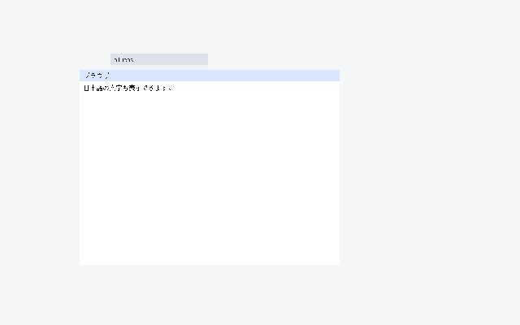

`guest-browser-caret` exit 0 means the same boot, after the event loop (window 2 focused, に committed, nothing composed), took `k` `a` and three Backspaces, each sent after the previous frame was on the display, and presented a frame after each: every frame ENDED with the focused window's caret -- Kotoba `kotoba_aiueos_browser_frame2`'s last op a 1 x 16 #111111 rect where the next glyph would go, after the composition when there is one (cssom `sel-ops`' collapsed selection) -- at the model's x on y 214 (458, 466, 450, 434, 418). The first Backspace dropped the preedit か; the next two found nothing composed, and Kotoba `kotoba_aiueos_browser_key` deleted the code point before the caret (browser.text-edit `delete-backward`) -- に, then 。 -- leaving window 2's body 13 code points. The five censuses fold into os/aiueos/scripts/browser-frame-model.cljk's chain (serial five `AIUEOS_GUEST_BROWSER_CARET_FRAME` lines and `AIUEOS_GUEST_BROWSER_CARET_OK keys=5 answers=00000 body=13 caret=418,214 chain=62295970 ops=80 text-px=867 hash=d039564f`, ADR-0232); the screendumps `guest-browser-caret-1.ppm` .. `-4.ppm` and `guest-browser-caret.ppm` count the same #111111 pixels as memory, and on the last the caret is the 16 px column at x 412. Every frame since `guest-browser-text` now carries the caret, so their numbers above were re-pinned from the same model. It does not mean the caret moves (arrow keys, Home / End, a click: `:caret-only-at-the-end`), blinks, or shows a selection.

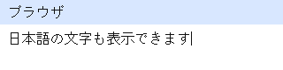

`guest-browser-launch` exit 0 means the same boot, after the caret, registered apps 1 2 3 in the surface's app register (word 31; app k's title and document are window slot k's, and slot 3 -- メモ, ランチャーから開きました -- was written then), so Kotoba `kotoba_aiueos_browser_frame2` drew a launcher row across the top (#edf0f5, 28 px) with a #e4e8ef button per app, and a 16 x 16 close control with U+00D7 in each window's titlebar. The host then sent eight virtio-tablet batches, each after the previous frame was on the display: a press on launcher button 3 at (258, 14), release, a press on window 3's close control at (584, 94), release, the launcher again, release, a press on window 2's close control at (820, 186), release. Kotoba `kotoba_aiueos_browser_reduce` decided every one -- browser.surface `launch-app` (window 3 at open-window's default rect (80, 80, 520, 360), on top, focused) and `close-window` (the window leaves the stack; the focus moves to the window now on top only if the closed one had it) behind the kernel's geometry -- and answered 3 0 2 0 3 0 3 0: closing the focused window 3 moved the focus to window 2, and closing window 2 while 3 was focused left the focus on 3. The eight censuses fold into os/aiueos/scripts/browser-frame-model.cljk's chain (serial eight `AIUEOS_GUEST_BROWSER_LAUNCH_FRAME` lines and `AIUEOS_GUEST_BROWSER_LAUNCH_OK events=8 answers=30203030 windows=2 stack=1,3 focus=3 chain=2845aee9 ops=108 text-px=776 hash=98b595bd`, ADR-0233); the answers and whole states are browser-reduce-v1's, whose oracle script applies browser.surface's own actions. The screendumps `guest-browser-launch-1.ppm` .. `-7.ppm` and `guest-browser-launch.ppm` count the same #111111 pixels as memory. With the register 0 -- every earlier gate -- nothing is drawn or hit differently. It does not mean a second window of an open app (`:one-window-per-app`: the launch raises the open one), closing the last window (`:the-last-window-stays`, refused -8), or apps beyond the four window slots (`:no-app-registry-beyond-the-slots`).

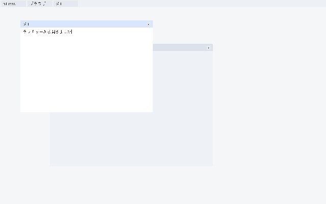

`guest-browser-ime-toggle` exit 0 means the same boot, after the preedit commit, took Hankaku/Zenkaku (evdev 41), `k a`, Hankaku/Zenkaku, `k a`, Enter, and Kotoba `kotoba_aiueos_browser_key` answered every key as ADR-0228's oracle vectors do: the first toggle turned the IME off (word 432 = 0), so `k a` went into window 1's body as latin; the second turned it back on, so `k a` Enter committed か. The frame that followed matched os/aiueos/scripts/browser-frame-model.cljk exactly (serial `AIUEOS_GUEST_BROWSER_IME_TOGGLE_OK presses=7 off=0 latin=2 committed=1 ime=1 ops=80 text-px=1205 hash=322e206e`), and the screendump `guest-browser-ime-toggle.ppm` counts the same 1,205 #111111 px. It does not mean the IME state is shown on screen (`:no-ime-indicator`), or that a composition survives a toggle: switching discards it, as the hosted desktop's `set-ime` does.

`guest-browser-flow-parity` exit 0 means KERNEL.ELF, with no tablet (the default profile; in the tablet profile after the launcher), laid out a four-window surface of its own with Kotoba `kotoba_aiueos_browser_frame2` and printed the whole op list (`AIUEOS_GUEST_BROWSER_FLOW_OPS n=158 words=...`), and every body glyph in it -- read per window by the span rule (from the window's body rect and titlebar rect to the next window's, the glyph ops at or below y + 28, as [dx dy glyph width] from the body box) -- equals, one by one, the glyphs kotoba-lang/browser's browser.surface + cssom.layout draw in the same window's body for the same surface (135 glyphs; `os/aiueos/contracts/browser-flow-parity-v1.edn`, written by `os/aiueos/scripts/browser-flow-oracle.cljk` from the hosted engine with the committed font's advances as cssom's `:measure-text`, each 10 a `<br>`), and the #111111 census equals os/aiueos/scripts/browser-frame-model.cljk (`AIUEOS_GUEST_BROWSER_FLOW_OK windows=4 ops=182 text-px=3593 hash=a19f95a8`, ADR-0234). The four bodies take each of cssom's rules: packing by words at W = w - 28 with space runs, a tab and U+3000 collapsed (the first line exactly W, the second a word past it), `<br>` segments trimmed with an empty one kept as a line, a CJK run overflowing its window, and a body that fits kept as collapsed with its leading and trailing space. The same contract holds the hosted answer for every frame the earlier gates pin, and the model reproduces all 68 window bodies (`browser-frame-model.cljk --parity`). It does not mean line breaking inside a CJK run (`:no-cjk-break-opportunity` -- cssom has none; a real browser breaks between ideographs), windows placed by cssom (`:windows-sit-at-their-rect`: the hosted workspace stacks them in block flow), or the hosted engine's overflow past the body's bottom and the viewport (`:kernel-clips-the-body`).

`guest-browser-dictionary` exit 0 means the tablet boot, after the launcher, booted with `ime/aiueos-kanji.dic` as the fifth initramfs entry (a kana-kanji dictionary generated in-repo from Unicode Unihan kJapaneseOn / kJapaneseKun, Unicode License v3, by `os/aiueos/scripts/gen-ime-dictionary.cljk`), the host typed `y a m a Space` and Kotoba `kotoba_aiueos_browser_key` converted やま to 山 by binary search (`AIUEOS_GUEST_BROWSER_DICT_SHOWN ... record=44512 cp=23665`), then cycled, restored the reading with Escape, committed 山 and committed 償 as しょう's second candidate (`AIUEOS_GUEST_BROWSER_DICT_OK keys=16 ... committed=23665,20767 ... hash=eaa427b3`) -- both censuses equal the frame model (ADR-0235).

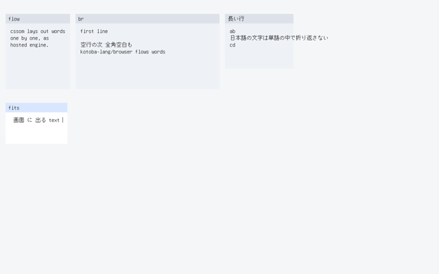

`guest-browser-cursor` exit 0 means the tablet boot, after the dictionary, said no frame before it had drawn a pointer (`AIUEOS_GUEST_BROWSER_CURSOR_GO events=5 before=0`), then took five tablet events -- moves to (400, 300), (700, 450) and (1276, 796), a press at (1000, 600) on no window, the release -- and for each C wrote the tablet's position into surface words 2046 (x + 1) and 2047 (y), Kotoba `kotoba_aiueos_browser_reduce` answered 0, and Kotoba `kotoba_aiueos_browser_frame2` ended the draw list with a 12-row arrow at the pointer, over every window (clipped to 4 rows at the bottom-right corner); every frame's op count and #111111 census equal the frame model's, the arrow's tip reads back #111111 from the framebuffer in every frame and its fill #ffffff in the last (`AIUEOS_GUEST_BROWSER_CURSOR_OK events=5 answers=00000 before=0 at=1000,600 tip=111111 fill=ffffff chain=f4bb42d8 ops=131 text-px=948 hash=3e8be657`). The pointer is drawn only from this stage on; earlier frames keep their pinned censuses (ADR-0236).

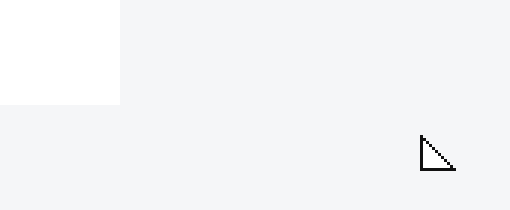

`guest-browser-focus-cycle` exit 0 means the tablet boot, after the pointer, took twelve events -- a press on launcher button 2 at (150, 14) and its release (window 2 opens on top: stack 1 3 2), Alt down, Tab down and up three times, Alt up, and a lone Tab down and up -- and for each key C handed code * 4 + value to Kotoba `kotoba_aiueos_browser_key`, which held Alt in surface word 431 and answered 256 + the bottom window's id for each Tab press under it (257, 259, 258); C handed that id to Kotoba `kotoba_aiueos_browser_reduce` as a `:window/focus` (kind 5), which focused and raised it -- stack 3 2 1, then 2 1 3, then 1 3 2 -- while Alt, the Tab releases and the lone Tab answered 0; a frame after each, every op count and #111111 census equal to the frame model's, the bodies (words 160..415) the same after the twelve keys as before them, and nothing left composing (`AIUEOS_GUEST_BROWSER_FOCUS_OK events=12 answers=200103020000 wm=3 stack=132 focus=2 bodies=unchanged chain=2254db31 ops=160 text-px=1082 hash=e90ed2bc`). The shortcut and its rule (the bottom window, so n presses visit every window) are the kernel's: browser.input has no window-manager shortcut (ADR-0237).

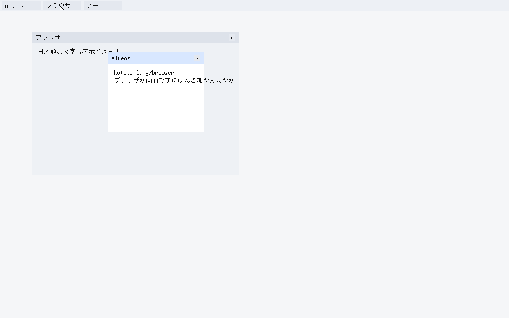

`guest-browser-title-active` exit 0 means that the focus-cycle boot (it needs `guest-browser-focus-cycle` green on the same serial) drew, in each of the twelve focus frames, exactly one window's titlebar in the focused colour and every other window's in the other, and that the focused one is where the focused window is: for each frame the kernel scanned the draw list it had just painted for the 28 px rects Kotoba `title-rgb` coloured and printed `AIUEOS_GUEST_BROWSER_FOCUS_TITLE n=<frame> active=<#cccccc rects> inactive=<#e6e6e6 rects> at=<x,y of the first focused one>`; all twelve equal what `os/aiueos/scripts/browser-frame-model.cljk` counts in its own op list (`title-frame`: active=2 inactive=4 in every frame, at=82,80 for the frames where window 2 or 3 is focused and 274,132 for the two where window 1 is, a window's titlebar being three rects of which two are 28 px high). A frame with two windows active, the active titlebar at the wrong window, a missing frame or no title lines is red, and each is a unit-tested case. It does not mean the pixels: the count is of ops in the list, not of the colours on the display, and nothing here is hover, an inactive body style or a contrast ratio.

`guest-browser-hover` exit 0 means that on the scroll boot (it needs `guest-browser-scroll` green on the same serial) a control under the pointer was drawn in the hover colour and one the pointer had left was not: Kotoba `hot` in `browser-frame2.kotoba` decides from the pointer in surface words 2046 (x + 1) and 2047 (y) that a launcher button or a close control is hot and colours it #d9d9d9 instead of #e6e6e6, and beside each frame of the cursor, focus and scroll stages the kernel printed `AIUEOS_GUEST_BROWSER_HOT stage=<stage> n=<frame> hot=<#d9d9d9 rects in the draw list just painted>`; all thirty-four lines equal what `os/aiueos/scripts/browser-frame-model.cljk` counts in its own op list (`hot-frame`): hot=0 in the five cursor frames (the pointer is over no control), hot=1 in the twelve focus frames (over launcher button 2 at (150, 14)), hot=1 in the first three scroll frames (over button 4 at (360, 14)) and hot=0 in the fourteen after the pointer moved to (300, 300). A control that stays hot after the pointer left, one that is hot where the pointer never was, a missing frame or no lines is red, each a unit-tested case. It does not mean the pixels (the count is of ops in the list), hover on the dock or on window bodies, a transition, or a focus ring.

`guest-browser-high-contrast` exit 0 means that after the damage stage (its OK line is required on the same serial) the host sent F10 down and up, F10 down and up, and the desktop switched to a high-contrast palette and back: Kotoba `browser-ime.kotoba` flips surface word 2039 on F10 (answer 0, no text and no window action), `browser-frame2.kotoba` reads it for the ink (#000000 instead of #333333), the background and launcher bar (#ffffff instead of #f1f1f2), the buttons (#e0e0e0, hot #ffd400), the shadow strips (#808080) and the titlebars (focused #ffd400, others #d0d0d0 instead of #cccccc / #e6e6e6), and for each of the four events the kernel printed `AIUEOS_GUEST_BROWSER_HC n=<event> mode=<0|1> bg=<op 0's colour> ink=<the first glyph's colour> bars=<the distinct colours of the 28 px rects, at most four> ops=211 text-px=2330 hash=5581e21a` (the census in the ink's own colour: black pixels with the palette on); all four equal what `os/aiueos/scripts/browser-frame-model.cljk` counts in its own op list (`uiux-frame`), the ink's pixels are the same set in both palettes, and the classifier computes the WCAG contrast of the ink against the background, the white body and every bar itself from the printed colours and is red below 7:1 (black on the bars is 13.6 to 21:1; the default palette is already above 7:1, #333333 on #cccccc being 7.9:1, so this is the larger margin and the black ink, not the first AAA). The palette off again after the second F10 is part of the line list. It does not mean the pixels (colours in the op list), the dock (it keeps its colours), a setting that survives a boot, or a system-wide preference.

`guest-browser-focus-ring` exit 0 means that after the palette frames the host sent F6 down and up twice, Shift down, F6 down and up, Shift up, and F6 down and up, and the keyboard focus ring went to launcher button 1, to button 2, back to 1, and to 2: Kotoba `browser-ime.kotoba` moves surface word 2032 (0 none, 1..4 launcher button k when app k is registered, 5 the focused window's close control) -- forward on F6, backward when Shift is held -- and answers 0, `browser-frame2.kotoba` draws four 2 px rects #1a56db outside the control it is on, and for each of the fourteen frames the kernel printed `AIUEOS_GUEST_BROWSER_KEY n=<5..18> ... ring=<word> ... rings=<#1a56db rects> at=<x,y of the first> ringc bar face ops text-px hash`; the ring, rect count, position (`4,0` around button 1, `106,0` around button 2), colours and censuses of all fourteen equal what `os/aiueos/scripts/browser-frame-model.cljk` counts in its own op list (`key-frame`), and the classifier computes the contrast of the ring against the launcher bar (5.5:1) and the button (5.0:1) from the printed colours itself and is red below 3:1. A ring on the wrong control, a Shift+F6 that does not go back, a ring too close to the bar in colour, a missing frame or no lines is red, each a unit-tested case. It does not mean Tab (Tab is the window switcher's with Alt and the input method's alone, so the ring is on F6), the ring on window bodies or the dock, the close control as a ring target in a boot (word 5 is implemented and not exercised), or the pixels.

`guest-browser-keyboard-activate` exit 0 means that on the same boot Enter and Escape did what a pointer press does: with the ring on button 2, Enter down made Kotoba answer the press at the button's centre (`answer=385038` = 65536 + 2048 x 156 + 14), C handed it to `kotoba_aiueos_browser_reduce` as a pointer/down exactly as a tablet press goes, `reduce=2` came back, window 2 was raised and focused (stack 3241 to 3412, text-px 1209), and Escape down made Kotoba answer the press at the focused window's close control (`answer=1261662`, centre 584,94), `reduce=1` came back, and the window was closed with the one now on top focused (windows 4 to 3, stack 341, text-px 2330 as before the launch); the key, the answer, the reduce result, the windows, focus, stack and censuses of all fourteen frames equal the frame model's. Enter that does nothing, Escape that leaves four windows, a press other than the pointer's, a missing frame or no lines is red, each unit-tested. It does not mean Space (it takes the same path in Kotoba and is not pressed in the boot), a menu, or that a composition in progress is unaffected (it is the input method's, as before, and is not part of this boot).

`guest-browser-window-maximize` exit 0 means that on the same boot, after the keyboard frames, the tablet double-pressed window 1's titlebar at (380, 142) -- press, release, press, release -- and the window filled the work area, then double-pressed its titlebar at (380, 40) and it went back to the rect it had: C counted the input events in surface word 2029 and called `kotoba_aiueos_browser_reduce` (state size 8192) with each tablet source and position, and Kotoba's `press` took the second press on the same window's titlebar with at most three events since the first as a double press (a press on the resize handle or the close control is not one), saved the window's rect in words 2010 + 4 (id - 1), set it to (0, 28, 1280, 720) -- below the launcher bar, above the dock -- and, the next time, put the saved rect back and cleared it; for each of the eight events the kernel printed `AIUEOS_GUEST_BROWSER_MAX n=<19..26> src at reduce windows focus stack rect ops text-px hash` and all eight equal what `os/aiueos/scripts/browser-frame-model.cljk` counts in its own op list (`max-frame`: rect 272,132,240,200 / 0,28,1280,720 / back, ops 180 / 179 / 180, text-px 2330 / 1699 / 2330), the maximized rect is the work area, and the rect after the restore is the one before the maximize. A second press that does not maximize, a restore to a rect off by one, a missing frame or no lines is red, each a unit-tested case. It does not mean a time threshold (the distance is the order of events), a maximize control or a keyboard shortcut (`guest-browser-maximize-control` below), a window opened with no launcher (the launcher branch only), or the pixels.

`guest-browser-maximize-control` exit 0 means that on the same boot (it needs `guest-browser-window-maximize` green on the same serial) the visible maximize control and F11 did what the double press does: Kotoba `browser-frame2.kotoba` draws, on every window that has a launcher and is at least 160 wide, a 16 x 16 control at (x + w - 44, y + 6), left of the close control, in the button face colour (hot under the pointer) with U+25A1 in #595959 (#404040 in the high-contrast palette) -- a colour of its own and not the ink, so the ink census of every frame is the one it was, and the title is clipped 20 px earlier on such a window -- and `browser-reduce.kotoba` takes a press inside it, with the whole surface, as the maximize toggle; the tablet's press at (476, 146) maximized window 1 (`reduce=1`, rect 0,28,1280,720, text-px 1699), and F11 down made `browser-ime.kotoba` answer the press at the control's centre (65536 + 2048 x 1244 + 42 = 2613290), C handed it to `kotoba_aiueos_browser_reduce` as a pointer/down, and the window went back to 272,132,240,200 (text-px 2330) -- the same action path as the pointer, not a second set of rules; the four `AIUEOS_GUEST_BROWSER_MAX n=27..30` lines (the key events with `src=0`) equal what `os/aiueos/scripts/browser-frame-model.cljk` counts in its own op list, and the rect after F11 is the one before the press. A control press that does not maximize, an F11 that restores to another rect, a missing frame or no lines is red, each unit-tested. Drawing the control moved the ops count of every frame with a launcher (70 and the earlier frames did not move; 131 became 137, 154 became 160, 203 became 211, and so on): the model re-derived every pin and the gates above were re-run on the new boot. It does not mean a control on windows narrower than 160 or without a launcher, a ring target for it, or the pixels.

`guest-browser-cursor-shape` exit 0 means that on the same boot (it needs `guest-browser-maximize-control` green on the same serial) the pointer was a resize cursor over a resize handle and the arrow again away from it: after F11 the host moved the tablet onto window 1's resize handle at (500, 320) -- the last 16 px of both axes of the topmost window under the pointer, as `browser-reduce` takes it -- and then to (380, 142); Kotoba `browser-frame2.kotoba` (`top-at`, `on-handle`, `cursor-resize?`, `resize-cursor`) drew, over the handle and with 6 px of room on every side, a 2 x 2 diagonal from (x - 5, y - 5) with an L at each end in the ink instead of the arrow (14 ops against the arrow's 21), and the kernel printed `AIUEOS_GUEST_BROWSER_MAX n=31, 32` with `src=3` (a pointer move; `browser-reduce` answers 0, nothing is captured); the two lines equal what `os/aiueos/scripts/browser-frame-model.cljk` counts in its own op list (`max-frame` 31, 32: ops 179 / text-px 2343 over the handle, 186 / 2330 away), the frame back at (380, 142) equals frame 19 -- the same window state and the same pointer position -- in ops, ink pixels and hash, so the arrow comes back exactly, and the two frames differ. A pointer that stays an arrow over the handle, one that does not go back, a missing frame or no lines is red, each a unit-tested case. It does not mean other cursor shapes (text, hand, move), the handle of a maximized window specifically, a hotspot adjusted per shape, or the pixels.

`guest-browser-pressed-state` exit 0 means that on the same boot (it needs `guest-browser-cursor-shape` green on the same serial) a control was drawn pressed while the pointer's button was down and hot again after: the host put the button down on launcher button 1 at (54, 14) and let it up; C wrote surface word 2033 on the tablet's press (1) and release (0), Kotoba `browser-frame2.kotoba` (`ctl-rgb`, `pressed-rgb`) drew a hot control #bfbfbf while the word is 1 (#e6b800 in the high-contrast palette) and #d9d9d9 otherwise, and the kernel printed `AIUEOS_GUEST_BROWSER_PRESS n=33 pressed=1 hot=0` and `n=34 pressed=0 hot=1` (the number of rects in each colour in the list it painted) beside the two `AIUEOS_GUEST_BROWSER_MAX` lines (the press raises app 1's already-open window and changes nothing else); all of them equal what `os/aiueos/scripts/browser-frame-model.cljk` counts in its own op list (`max-frame` 33, 34 and `press-frame`). A control that is not pressed while the button is down, one that stays pressed after the release, a press that changes the window state off the model, a missing frame or no lines is red, each a unit-tested case. It does not mean a disabled state, tooltips, a pressed state on the dock, or the pixels (colours in the op list).

`guest-browser-suspend` exit 0 means that on the same boot (it needs `guest-browser-audio` green on the same serial) the machine suspended to idle and resumed with its state intact: the host took a screendump of the awake desktop, pressed the sleep key (the lid), took one of the sleeping screen (all black), pressed the wake key, timed the resume (under 3 s; 51 ms measured, harness included) and took a screendump of the awake desktop again, byte-identical to the first (equal SHA-256); the kernel's fingerprint of the 2048 surface words is equal before and after (ADR-0273). Not ACPI S3: the RAM stays powered; the lid is a key.\n\n that on the same boot (it needs `guest-browser-backup` green on the same serial, and a virtio sound card whose output QEMU writes to `audio.wav`) the machine played a sound at a set level: a polled virtio-sound driver played a 440 Hz burst at volume 100, the host pressed the volume-down key twice (100 -> 75 -> 50), and the burst played again at 50; the HOST measured the WAV: two bursts of about 0.4 s at 440 Hz, the second at 0.45..0.55 of the first's RMS (ADR-0272). The volume is a software gain in the stage; no mixer UI, no mute, one stream, no playback of audio files.\n\n that on the same boot (it needs `guest-browser-sign-out` green and the settings stage's first-boot frames equal to the model's) the user's records survived a backup, a wipe and a restore: the settings record (sector 1034) and the passkey record (1035) were copied to sectors 1036 and 1037, wiped (the machine then saw no settings and no passkey), restored, and read back byte for byte (SHA-256), with the same settings (contrast high, 125 %, network off) and the same signing key (same public point, signs and verifies) (ADR-0271). The user data is two records, the backup is on the same volume.\n\n that on the same boot (it needs `guest-browser-notify` green on the same serial) the lock opened for a device-bound passkey and refused another device's: the host locked the screen (Ctrl+Alt+L), pressed F3 (a passkey made on another device) and F4 (this device's); each time C ran a challenge/signature/verification ceremony against the public point registered on this volume (a P-256 key drawn from the virtio-rng and kept in sector 1035); the other device's signed but did not verify (the red bar), this device's verified and opened a session (its id is printed); all 10 frames equal the frame model's (ADR-0270). The private key sits in the clear on the volume; user presence is the key press.

`guest-browser-notify` exit 0 means that on the same boot (it needs `guest-browser-layout` green on the same serial) a notification appeared, could be dismissed and was listed: the stage raised two notifications ("Backup", "Update"), both drawn as toasts; the host pressed F8 (the newest toast goes, it stays in the list), F7 (the list opens and shows both), F7 (it closes), F8 (the other goes), F7, F7; all 15 frames equal the frame model's (ADR-0268). Keyboard-only; raised by a test hook, not a real app call; no timeout.

`guest-browser-layout` exit 0 means that on the same boot (it needs `guest-browser-clock` green on the same serial) the keyboard layout changed the characters produced: after the clock stage the host typed shift+2, 2, shift+a, shift+;, shift+' on the US layout, pressed F9 (JIS) and typed shift+2, shift+', the key right of P and shift+; on the same physical keys, then F9 again; all 36 frames equal the frame model's (US gives `@2A:"`, JIS gives `"*@+`) (ADR-0267). English mode only; US and JIS only; not kept across a reboot.

`guest-browser-clock` exit 0 means that on the same boot (it needs `guest-browser-text-edit` green on the same serial) the launcher row showed the time: the stage sets the machine\'s real-time clock to 12:34 (the test hook), reads it back through the CMOS registers (`CLOCK_RTC set=12:34 read=12:34`) and reports the minute of the day + 1 in surface word 1968; browser-frame2 draws HH:MM at the right end of the launcher row (77 ops without, 82 with it: five glyphs, 755 ink pixels). Both frames equal `browser-frame-model.cljk`\'s ("clock-frame"). Named leftovers: the clock only -- no power state (the kernel reads no battery device) and no network state (the desktop stages run before the network is up) -- set by the test hook, not refreshed each minute.

`guest-browser-text-edit` exit 0 means that on the same boot (it needs `guest-browser-keyboard-only` green on the same serial) text could be edited like a text field: after the keyboard-only stage the host sent seventy-two keys to the clean session\'s empty window -- "ab cd" typed; Home, Right Right; Ctrl+Right and Ctrl+Left (by word); Left; x typed at the caret and Ctrl+Z undoing it; Shift+Right twice selecting " c", Backspace deleting the selection and Ctrl+Z bringing it back; Delete; Enter and e; Left Left (onto the line break), End, Home, End, Right, End; Shift+Home selecting the second line and Left collapsing it. The caret is an index now (ADR-0263: word 2004, with the selection\'s anchor in 2005 and the undo record in 2006), so editing happens at the caret; the kernel prints `AIUEOS_GUEST_BROWSER_EDIT n= key= text= caret= sel= ops= text-px= hash=` and green needs them equal to `browser-frame-model.cljk`\'s ("edit-frame", whose editing rules are written apart from the Kotoba) and the text and caret at the steps that name a rule to be what the rule says. All earlier gates (caret, selection, clipboard, type, preedit) are green on the same boot. Named leftovers: no pointer-placed caret, no Up / Down, no composition at the caret in the middle of the text, undo is one step with no redo, English-mode typing only.

`guest-browser-keyboard-only` exit 0 means that on the same boot (it needs `guest-browser-sign-out` green on the same serial) the shell could be used without a pointer: after the UI scale stage the host sent twenty-eight keys -- F6, Enter and Escape, down and up. F6 moves the focus ring (ADR-0248, extended by ADR-0262 to eleven targets) through every shell control that exists: launcher buttons 1..4, the focused window\'s close, maximize and minimize controls, and the tray\'s buttons; Enter activates the one it is on, as the pointer press at its centre that Kotoba answers and C hands to browser-reduce. The sequence opens window 2 from launcher button 2, maximizes it (0, 28, 1280, 720), minimizes it, restores it from the tray\'s button, puts the ring away and closes it with Escape. The kernel prints `AIUEOS_GUEST_BROWSER_RING n= key= ring= windows= focus= stack= min= top= ops= text-px= hash=`; green needs them equal to `browser-frame-model.cljk`\'s ("ring-frame"), every event a keyboard event, the ring on each control 1..8 and each Enter doing its action. Named leftovers: nothing to focus inside a window (a document is text), no move or resize by key, the draw list and not the pixels.

`guest-browser-ui-scale` exit 0 means that on the same boot (it needs `guest-browser-sign-out` green on the same serial) the whole desktop could be enlarged: after the sign-out stage the host sent F11 (the clean session\'s window is maximized), Ctrl+= three times and Ctrl+- twice, and F11 again. Kotoba chose the scale (ADR-0261: 100, 125, 150 and back, 150 the top) and fitted the window into the logical viewport (1024 x 640 at 125, 853 x 533 at 150); C magnified what it painted and set the viewport words. The kernel prints `AIUEOS_GUEST_BROWSER_SCALE n= key= pct= vw= vh= win= ops= text-px= hash=` for the sixteen keys; green needs them equal to `browser-frame-model.cljk`\'s ("scale-frame", whose census paints the scale as the present does: 582 ink pixels at 100, 1536 at 125, 1828 at 150), the window inside the viewport in every frame, and, back at 100 and restored, the rect it had. Named leftovers: nothing above 150 (the default window needs a 600 x 440 viewport), nearest-neighbour magnification, the scale is not persisted, no settings window.

`guest-browser-settings` exit 0 means that contrast, scale and the network setting were changed in a settings window and survived a reboot: the gate boots the same volume twice (a NIC attached); on the first boot window 2 ("Settings") opens from a press on launcher button 2 and three pointer clicks on the lines of its body turn the contrast high, the scale to 125 % and the network setting off (the status area goes from ONLINE to OFFLINE), each change written to the volume with readback; on the second boot the stage reads the record, opens the window with the stored values, writes nothing, and draws the frame boot one ended on; every frame equals the frame model's (ADR-0260, ADR-0265, ADR-0269). The network setting is a shell flag, not the adapter; the controls are lines of text, not drawn buttons.

`guest-browser-sign-out` exit 0 means that on the same boot (it needs `guest-browser-screen-lock` green on the same serial) the session ended and a new one began clean: after the lock events the host sent Ctrl+Alt+Q (the session is zeroed -- every window body, scroll offset, saved maximize rect, selection and the minimized register -- one fresh window 1 stands at the default rect, and the screen locks) and the PIN 4 2 4 2 and Enter (signed in: windows 1, focus 1, 72 ops against the 187 of the three-window session). The kernel prints `AIUEOS_GUEST_BROWSER_MAX n=91..106`, `AIUEOS_GUEST_BROWSER_LOCK` and `AIUEOS_GUEST_BROWSER_SIGNOUT n= body= scroll= maxrect= minreg= windows= focus=` (the non-zero words it reads back from the surface); green needs the first two equal to the frame model\'s and, apart from it, data before the sign-out (body words non-zero) and none after. Named leftovers: only the desktop session\'s words are zeroed and read from the surface, not from the RAM behind it; the clipboard held by the broker is not cleared; the same test PIN signs in; no account switch.

`guest-browser-screen-lock` exit 0 means that on the same boot (it needs `guest-browser-minimize` green on the same serial) the screen locked and a PIN unlocked it: after the minimize events the host sent Ctrl+Alt+L (the frame becomes the lock screen: 30 ops, no window bar), a press at (456, 146) and a key (x) (both change nothing), a wrong PIN 4 2 4 3 and Enter (refused: the red bar, still locked) and the right PIN 4 2 4 2 and Enter (unlocked: windows 3, focus 4, stack 314, as before the lock; 187 ops, the focus ring cleared). Kotoba decides (ADR-0258: browser-ime collects the digits and swallows every other key, browser-reduce ignores the pointer, browser-frame2 draws only the lock screen); C only checks the PIN against its SHA-256 and sends the verdict back. The kernel prints `AIUEOS_GUEST_BROWSER_MAX n=61..90` and `AIUEOS_GUEST_BROWSER_LOCK n= locked= bars= dots= denied=`; green needs them equal to `browser-frame-model.cljk`\'s ("max-frame", "lock-frame"), no window drawn while locked, the wrong PIN leaving it locked, and the session restored. Named leftovers: the image carries the TEST PIN\'s hash (4242), no first-run provisioning, no attempt limit, no idle lock, no passkey, the draw list and not the pixels.

`guest-browser-minimize` exit 0 means that on the same boot (it needs `guest-browser-pressed-state` green on the same serial) a window was minimized and restored from the dock: after the launcher press the host pressed window 1's minimize control at (456, 146) (16 x 16, left of the maximize control, drawn only while two or more windows are visible), pressed (380, 142) where the window is, and pressed app 1's dock icon at (574, 772), each with its release. Kotoba decides (ADR-0254): browser-reduce marks the window in the minimized register (surface word 31, bits 4..7) and gives the focus to the topmost window that is not minimized, a minimized window is not hit (the second press raises window 4, answering 4, stack `314`) and the dock press clears the bit and raises and focuses it; browser-frame2 does not draw a minimized window (192 ops to 133) and puts a bar under its dock icon. The kernel prints `AIUEOS_GUEST_BROWSER_MAX n=35..40` and `AIUEOS_GUEST_BROWSER_MIN n=35..40 reg= minctl= dockbar=` from the draw list; green needs them equal to `browser-frame-model.cljk`'s ("max-frame", "min-frame"), the minimized frame smaller than the frame before it, the press where the window was not answering window 1, and the restored frame back to the op count it had. ADR-0255 adds a tray of minimized windows (bottom left, one titled 120 x 24 button each): the window is minimized again (events 41, 42, tray=1) and restored from the tray button at (60, 780) (43, 44). ADR-0256: Alt+- minimizes the focused window (events 45..48: Alt, `-`, `-` up, Alt up; Kotoba answers the press at the control's centre, 999570) and the tray restores it (49, 50). ADR-0257: with window 1 and then window 4 minimized (events 51..54) window 3 is the only visible window and its close control is drawn disabled (a #9e9e9e glyph, never hot; `dis=1`); a press on it is refused (`reduce=refused`, 55, 56), and two presses on the tray button restore window 1 and window 4 (57..60). Named leftovers: the list holds minimized windows only (not a list of every open window), no animation, no other shortcuts, no tooltips, the control hidden with one visible window, the draw list and not the pixels.

`guest-browser-scroll` exit 0 means the tablet boot, after Alt+Tab, registered app 4 (title スクロール, its document the lines 1 .. 20) and took seventeen tablet events -- a press on launcher button 4 at (360, 14) and its release (window 4 opens at (80, 80, 520, 360) on top, fifteen of its twenty lines inside it), a wheel notch over no window at (360, 14), a move to (300, 300), six notches toward the end and seven toward the start -- and for each C handed the batch (a REL_WHEEL batch as tablet kind 6 or 7) to Kotoba `kotoba_aiueos_browser_reduce` with the whole 8192-byte surface, which scrolled the window under the pointer by 20 px a notch (browser.input `:pointer/wheel` -> browser.surface `scroll-window`, clamped at 0, no focus, no raise) in surface word 2039 + id, while the notch over no window scrolled nothing; Kotoba `kotoba_aiueos_browser_frame2` drew window 4's body the offset higher and cut it at the top inset (y + 36); the offset went 0 -> 120 -> 0, the seventh notch toward the start held it at 0, a frame after each event, every op count and #111111 census equal to the frame model's (`AIUEOS_GUEST_BROWSER_SCROLL_OK events=17 answers=40004444444444444 max=120 stack=1324 focus=4 scroll=0 chain=7421f3aa ops=205 text-px=994 hash=78270fda`). A notch is one 20 px line and only the vertical offset is kept; the offset has no upper clamp (as browser.surface) and a ceiling of 65535 (ADR-0238).

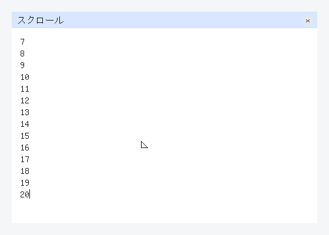

`guest-browser-selection` exit 0 means the tablet boot, after the wheel, took seventeen events -- five wheel notches toward the end at (300, 300) (window 4's offset 20 .. 100, line 20 inside the window), then Shift down, Left down / up, Left down / up, Right down / up, Left down / up, Shift up, Backspace down / up -- and for each C handed the tablet batch to Kotoba `kotoba_aiueos_browser_reduce` with the whole surface or the key (code * 4 + value) to Kotoba `kotoba_aiueos_browser_key`, which held Shift in surface word 2035 and ran browser.text-edit `move-caret` with `:extend?` on the focused body -- the selection kept as the last k code points, word 2036 its window id and 2037 k: "0", "20", "0", "20" -- and `delete-backward`, which deleted the selected "20" (body 50 -> 48 code points, k 0); Kotoba `kotoba_aiueos_browser_frame2` drew a #b5cdf1 rect behind each selected glyph (cssom sel-ops' rgba(70,130,220,0.4) over #ffffff; the blit has no alpha) and no caret while something was selected, with its op capacity 259; a frame after each event, every op count, #111111 census and #b5cdf1 census equal to the frame model's (`AIUEOS_GUEST_BROWSER_SELECTION_OK events=17 answers=44444000000000000 max-sel=2 body=48 focus=4 scroll=100 chain=2b46197d sel-chain=cb830579 ops=209 text-px=1058 hash=6ca5ee4a`). The caret is still only at the end outside a selection, one window's selection is kept at a time, and the arrows do nothing while something is composed (ADR-0240).

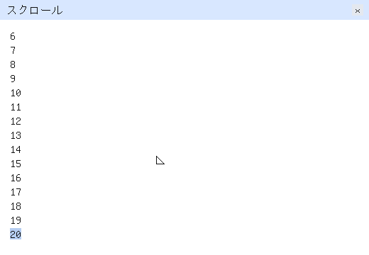

`guest-browser-clipboard` exit 0 means the tablet boot, after the selection, took twenty-two key events -- Shift down, Left down / up three times, Shift up, Ctrl down, C down / up, Ctrl up, Backspace down / up, Ctrl down, V down / up three times, Ctrl up -- and for each C handed the key (code * 4 + value) to Kotoba `kotoba_aiueos_browser_key`, which held Ctrl in surface word 2038, selected "19" and its 10, and answered Ctrl+C with a `:clipboard/write` request (512) and each Ctrl+V with a `:clipboard/read` request (513) without touching anything; C asked Kotoba `kotoba_aiueos_broker_admit` (ADR-0096) with the stage's grant -- clipboard for the first nineteen events, file-picker only from the twentieth -- and handed the completion (the same code with value 3, and the 260-byte clipboard in place of the dictionary) only when it answered 1: the copy put the three selected code points in the clipboard, Backspace deleted the selection (48 -> 45 code points), the two admitted pastes were browser.text-edit `insert-text` of "19\n" (45 -> 48 -> 51) and the refused third pasted nothing; a frame after each event, every op count, #111111 census and #b5cdf1 census equal to the frame model's (`AIUEOS_GUEST_BROWSER_CLIPBOARD_OK events=22 requests=4 admitted=3 refused=1 copied=3 pasted=3,3 clip=3 body=51 focus=4 chain=9098b95f sel-chain=356612c5 ops=210 text-px=1080 hash=76577905`). Only text, only Ctrl+C / Ctrl+V, nothing while something is composed, and the clipboard is the kernel's buffer, not the host's (ADR-0241).

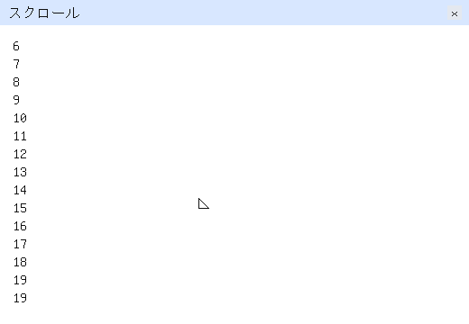

`guest-browser-damage` exit 0 means that on the tablet boot every show of the desktop sent the display only the rectangle Kotoba `kotoba_aiueos_browser_damage` answered -- the bounding box of every op, in the list last sent or the one just painted, at a slot where the two differ; nothing when they are the same; the whole screen when there is no previous list -- through virtio-gpu TRANSFER_TO_HOST_2D and RESOURCE_FLUSH with that rectangle (`AIUEOS_GUEST_BROWSER_DAMAGE_RUN shows=110 partial=66 empty=43 whole=1 refused=0`: one whole-screen send in the whole boot, and the eighteen earlier browser classifiers exit 0 on the same serial); that after the clipboard the host moved the tablet to (320, 310) and sent Alt down, Tab down (Alt+Tab raises window 1), Tab up and Alt up, and the five `AIUEOS_GUEST_BROWSER_DAMAGE_FRAME` rectangles were `os/aiueos/scripts/browser-frame-model.cljk`'s (300,300,32,22 / none / 80,80,652,716 / none / none, 1,870,144 bytes where five whole presents are 20,480,000); that after each frame the host screendumped the display, pressed F12 so the kernel sent the whole screen, and screendumped again, and all five damage screendumps are byte-identical to their whole-screen ones, all written by this boot, with the raise visible (frame 3's screen is not frame 1's); and `AIUEOS_GUEST_BROWSER_DAMAGE_OK events=5 partial=2 empty=3 bytes=1870144 whole-bytes=20480000 focus=1 chain=6653b143 ops=211 text-px=2330 hash=5581e21a`. Screendumps missing or older than the boot are exit 3 (the display was not measured). It does not mean the smallest rectangle (the box is slot by slot, so a raise sends the whole union of both windows), more than one rectangle per frame, vsync or fences, or hardware other than QEMU TCG.

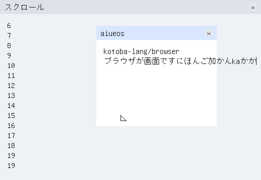

```bash
kbb -M:compositor serve   # same SPA; compositor owns surfaces; Ctrl-C to stop
```

`kbb -M:phone-bind smoke` stays headless **without** the GPU device. Display-present (動線 D) is extra, not the only bind path. Native compositor remains leftover. P5 remains UNVERIFIED. kami-engine as the daily desktop, CACAO write, and physical boot remain. The Chrome OS-shaped desktop goal is not complete.

## Bare-metal cloud reach (P2) — green on QEMU UEFI

Root contract: P2 of [`adr-2608221625`](https://github.com/com-junkawasaki/root/blob/main/90-docs/adr/2608221625-aiueos-chromeos-cloud-desktop.edn). This is QEMU **UEFI + KERNEL.ELF**, not the hosted JVM profile.

```bash
kbb -M:bare-metal cloud
```

The guest consumes its DHCP lease, resolves `kotobase.net`, completes TLS 1.3 (cipher 0x1301), GET `/ipfs/<empty-raw-cid>`, and admits the body SHA-256 (ADR-0082). **Exit 0 is guest HTTP GET + CID verify.** Handshake without HTTP is leftover `:http-absent`. A TLS record without Finished is `:tls-handshake-incomplete`. CertificateVerify (ECDSA P-256 against the leaf) is a separate gate: `kbb -M:bare-metal cert-verify` (ADR-0087). HTTP+CID without that serial line is leftover `:cert-verify-hashed-only`. Chain to a trust anchor is still leftover.

`kbb -M:cloud-live check` and `kbb -M:session smoke` do **not** green this gate. A Mac-side fetch is `:host-fetch-does-not-count`.

## Grant-limited guest in the shell (P3)

Root contract: P3 of [`adr-2608221625`](https://github.com/com-junkawasaki/root/blob/main/90-docs/adr/2608221625-aiueos-chromeos-cloud-desktop.edn). Same `apps/session` DADS SPA. `:app/notes` runs through `grant` + Chicory Wasm (`examples/apps/notes.wat`). A deny is HTTP 403 with `:unresolved-capability`, not a generic 500. POSIX `:fs/open` is not the store; kotobase write without a credential is `:write-unauthorized`.

```bash
kbb -M:session guest
```

Expected markers:

- `AIUEOS_GUEST_URL=http://127.0.0.1:<port>/#session`
- `AIUEOS_GUEST_SPA=admitted`
- `AIUEOS_GUEST_DENY=` … `"reason":"unresolved-capability"` and HTTP 403
- `AIUEOS_GUEST_ALLOW=` … `"decision":"grant"`, `"visible":true`, `"component":"app/notes"`, log `hi`
- `AIUEOS_GUEST_ALLOW_LIST=` lists the guest under `guests`
- `AIUEOS_GUEST_OK`

Exit 0 means the SPA listed the guest, grant allow ran it, and grant deny was the named red. This is **not** the full Chrome OS-shaped desktop: P2 guest HTTPS to kotobase is green on QEMU; CertificateVerify is green on QEMU (ADR-0087); P4 itonami is green on hosted JVM; P5 a real machine is UNVERIFIED; kanji and CACAO write remain. Guest virtio-gpu 2D is `kbb -M:compositor gpu` (ADR-0084), not this guest-in-shell gate.

## Maturity

Tracked M0-M6 in `docs/coverage.edn` (template borrowed from
`kotoba-lang/kotoba-lang`'s `docs/lang/coverage.edn`).

Contract maturity and native-product maturity are separate. The C-free
production chain currently boots through UEFI, validates a bounded final
memory map, and has its first physical allocator slice; paging, interrupts,
scheduling, CPL3/syscalls, capability tables, and native effect providers
remain subsequent aiueos gates. The detailed, test-backed truth is the Phase
table in ADR-0013, not the amount of reference C code present in this tree.

## Target-neutral and distributed stack architecture

Owns boot, memory, process and device mechanisms for the modern Kotoba Lisp machine direction. It enforces grant decisions and consumes verified native compiler artifacts. Wasm is an optional execution profile, not the language foundation. OS deployment does not require DHT, IPFS or global consensus. Existing hybrid, C-free, QEMU and physical qualification remain separate.

See the [owner integration guide and dependency direction](docs/stack-architecture.md),
[composition metadata](spec/stack-integration.edn), and
[whole-stack refactor procedure](https://github.com/kotoba-lang/kotoba-lang/blob/main/docs/stack-refactor-procedure.md).
The direction is adopted; runtime contract migration and qualification remain
explicit, separately verified work. Tier labels are responsibility axes, not
a single dependency ranking.

## Neutral execution and target profiles

Execution descriptors are owned by `kotoba.core.execution` in core-contracts;
Component/WASI admission belongs to `kotoba.abi.component` in abi. Upstream
consumer pins follow these entrypoints. Native remains an independent AMU target,
and legacy v1 wire fields/CIDs remain compatible. See
[the integration spec](spec/execution-profile-integration.edn) and
[whole-stack procedure](https://github.com/kotoba-lang/kotoba-lang/blob/main/docs/stack-refactor-procedure.md).
The dependency update does not enable default v2 runtime admission or qualify
new target/host/consistency combinations.
