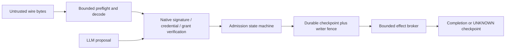

# Accountable admission v0 (AWAI-95)

`src/hata/admission.kotoba` implements the complete bounded, deterministic
**post-verification reservation state machine**, with seven public functions.
It is a new internal component, not a migration/qualification of the existing
imported CLJK conductor, `hata.call`, transport, signature stack or membership system.
The network protocol and accountability design are owned by
`network-awai/network-awai-apex` (AWAI-93). This document specifies the component's
exact interface and the integration gates still required by AWAI-22/AWAI-30.

The canonical owner is `kotoba-lang/kotoba/lib/kotoba.hata`; the former
`kotoba-lang/hata` repository is archived. Native source/test/observer bytes
were preserved when moving this change into the monorepo.

## Trust boundary and current deployment state

The component has **no wire endpoint, capability imports or effect permit**.
It must be called only by the trusted conductor after the following checks:

1. Bounded framing/queue preflight, then bounded decoding and verification.
2. Authentic request, coupon and grant signatures, canonical full-byte hashes,
   accepted issuer/policy, current revocation state and audience/scope binding.
3. Valid accountable membership: the exact actor and its current delegation
   bind to a verified persistent responsible principal. A bot needs that binding
   too. Human identity proofing is a separate process; a wallet key is insufficient.
4. The rule Form and grant owner explicitly authorize the exact operation,
   destination and data labels. Grant limits derive from authenticated grant
   bytes, never from a caller's asserted limits. The conductor checks that the
   declared resource cost covers the actual operation before executing it.

Those checks and the adapter are **not implemented by this module**. An
application, remote client or LLM must never be allowed to construct the internal
vectors, call completion/recovery or supply an authority callback. There is no
`verified=true` or LLM decision parameter. This module does not replace
`hata.call/admit`, judge signatures or authorize a request on its own.

An integrator must retain canonical envelope bytes/proofs and their verifiable
connection to the stored commitments for the declared retention window. A row
containing a principal digest is not itself proof of an accountable real person.
No identity data is collected, disclosed or sent by these functions.



Only A is implemented here. P's length/queue predicate is available, but no
decoder or listener is installed. V, C, E, receipt signing, issuer federation,
credential opening and independent-node qualification remain integration gates.
The LLM cannot change the state machine's rules; prompt filtering is not an
authorization boundary. Failure/absence of an LLM does not affect this component.

## Native ABI

Version 1 uses fixed `:vector-i64` frames. This avoids implicit host objects and
keeps complete comparisons bounded. Every digest is **all 256 bits**, represented
by four signed i64 limbs from the canonical SHA-256 byte string, little-endian
within each limb. All-zero digest fields are reserved as invalid identities.
These are internal representations, **not a newly standardized wire codec**.
Synthetic test values test comparisons; they do not qualify SHA-256/Ed25519.

The canonical request commitment must domain-separate protocol/schema/domain and
cover the operation, arguments, destinations, data labels, principal/actor/grant,
coupon, epochs, policy, times and all costs/ceilings. The commitment field itself
is excluded from its own preimage. The adapter must verify it against the full
canonical envelope, not accept the digest as an authenticated claim. Definitions
of canonical bytes and cryptographic verification remain with ABI/codec owners.

### State and initialization

A state contains 24 header words followed by zero to 64 rows of 57 words.
`admission-initialize(config)` accepts only a valid, empty genesis header with
sequence 0, row count 0, decision 0 and selected row -1. It copies the input.
It is not a reset/recovery API; reinitializing a service would discard spent
coupons. The host must distinguish creation from restoration durably and refuse
genesis for an existing domain. There is no reset, row pruning or automatic refill.

| Header index | Meaning |
|---|---|
| 0 | schema = 1 |
| 1 | positive writer epoch |
| 2 | positive policy generation |
| 3 | monotonic committed transition sequence |
| 4 | trusted time of last state transition |
| 5 | row capacity, 1–64 |
| 6 | row count |
| 7 | last decision code |
| 8 | selected zero-based row or -1 |
| 9–12 | domain digest |
| 13–16 | exact operation/interface binding digest |
| 17–22 | remaining requests, ingress bytes, egress bytes, fuel, memory bytes, storage byte-seconds |
| 23 | maximum request payload bytes |

Every row contains status at offset 0, reservation sequence at 1, completion
sequence at 2, result commitment at 3–6, and the **entire 50-word request** at 7–56.
Row status: 1 reserved, 2 succeeded, 3 failed, 4 UNKNOWN. These are distinct from
decision codes. Budget is reserved in all six dimensions before a row appears.
No terminal outcome automatically refunds budget; this deliberately conservative
version charges even failed/unknown operations and memory for the coupon's use.
It does not yet implement concurrent-memory release or storage-time accrual.

The state is internal host data. Structural validation checks the header and
bounded length; it is not a MAC, authenticated snapshot decoder or a proof of
ledger history. Restore must validate a signed/hash-bound trusted snapshot and
its external monotonic anchor. Do not hand attacker-controlled states to this API.

### Authenticated request (exactly 50 words / 400 bytes)

| Request index | Meaning |
|---|---|
| 0 | schema = 1 |
| 1 | writer epoch |
| 2–3 | not-before and exclusive expiry |
| 4 | exclusive accountable membership expiry |
| 5 | policy generation |
| 6 | verified member class: 1 person, 2 delegated bot |
| 7 | exclusive actor/delegation expiry |
| 8 | payload byte count |
| 9 | retention-until, at least coupon expiry; actual host retention may be longer per explicit policy |
| 10–13 | domain digest |
| 14–17 | exact operation/interface binding digest |
| 18–21 | coupon digest |
| 22–25 | request commitment |
| 26–29 | private persistent responsible-principal commitment |
| 30–33 | actor/device commitment |
| 34–37 | authenticated grant commitment |
| 38–43 | requested resources in the same six-dimensional order as the state |
| 44–49 | authenticated grant resource ceilings in that order |

Request cost is exactly one request; ingress cost must cover 400 frame bytes plus
the payload. Costs and ceilings are nonnegative signed i64 values. Bounds are
checked using subtraction after a lower bound, avoiding overflow of ingress
addition. Domain/operation comparisons include all four limbs. Costs must fit
both the grant and the remaining service budget.

`admission-preflight(frame-bytes, payload-bytes, max-payload, queued, capacity)`
checks frame length, payload bound and queue room before cryptographic work.
The host separately limits proof/signature bytes, verification work, dependencies,
connections and logging. This predicate alone is not a DoS defense.

### Submission and completion

`admission-submit(state, request, trusted-now, committed-anchor, writer-epoch)`
checks the anchor, epoch, shape, domain/operation/policy, validity windows and
payload limit, then scans the bounded journal for coupon **or** request reuse.

- An exact 50-word duplicate selects the existing row, without new spending,
  sequence increment or execution. Authentication must still be current.
- Same coupon with changed request/actor/principal/grant, or same request
  commitment with another coupon, is a conflict. No reexecution.
- A new request reserves all resources and appends one row in the same returned
  state. A full journal refuses even if resources remain; a duplicate still works.
- Errors/duplicates alter only response metadata (header words 7–8); they do not
  create committed transitions or advance time. The host uses monotonic trusted
  time and persists transition states rather than treating response metadata as
  a separate durable event. It may normalize those metadata words in its codec.

`admission-complete(state, request-digest, outcome, result-digest, context)` takes
`context = [trusted-now, committed-anchor, writer-epoch]` to keep the public ABI
within five arguments. The caller is the trusted effect broker. Outcomes 2/3/4
mean success/failure/UNKNOWN. Success and failure require a nonzero result
commitment; UNKNOWN may have a zero commitment when no observation exists.
An identical terminal completion is idempotent. Changing a terminal outcome or
result commitment is refused, including automatic UNKNOWN→success reconciliation.
Manual reconciliation needs a separately designed evidence-bearing transition.

`admission-row-status(state, request-digest)` returns the internal row status,
0 if absent, -1 on invalid header/digest length. It is not a public query endpoint.
`admission-status(state)` returns the last decision or 10 for malformed state.

### Stable request IDs at the integration boundary

The four-limb request commitment identifies the complete authenticated envelope,
including coupon and epoch. It is not a stable logical request ID. The adapter's
durable journal must separately bind `(domain, responsible principal, request ID)`
to the accepted request commitment and original outcome before admission. Reusing
that ID with changed bytes, a fresh coupon, actor key or epoch must return the
original outcome or a conflict, never dispatch again. UNKNOWN remains uncertain.
This module's digest/coupon indexes alone cannot enforce that cross-envelope
identity. The future signed-envelope/checkpoint profile must carry and retain the
stable ID explicitly; new coupons or regenerated digests must not reset it.

### Persistence, fencing and recovery

The returned reservation is **not permission to dispatch**. The conductor must
serialize operations under an independent fenced writer and:

1. Read the latest committed snapshot and its external sequence/epoch authority.
2. Compute the candidate, then atomically CAS/checkpoint the complete reservation
   (spent coupon + budget + journal) against that authority before effects.
3. Dispatch at most once with a sink-enforced idempotency key/fence when available.
   A failed or uncertain checkpoint never authorizes dispatch. A process crash
   after reservation but before dispatch is conservatively uncertain on recovery.
4. Checkpoint the observed completion. A timeout, lost completion or uncertain
   external commit becomes UNKNOWN; do not retry, refund or assert success.

`admission-recover(state, trusted-now, committed-anchor, old-epoch, new-epoch)`
requires an exact latest anchor and a strictly increasing epoch. It increments
the sequence and changes **every reserved row** to UNKNOWN, preserving all
resources, tombstones and terminal results. The host must durably publish the
new fence before using the recovered state. Old requests/writers are refused;
re-issuing the same request in the new epoch is still a conflict.

The integer anchor argument alone does **not** prove freshness. An old snapshot
paired with its old anchor still looks internally consistent. A single local
file or this pure function cannot defeat privileged rollback, split-brain or a
malicious host. Independent durable monotonic storage/fencing is a required,
currently unimplemented integration gate. Retention is finite by policy, but
safe expiry/compaction/key retirement is not implemented; this bounded prototype
must stop when full instead of dropping spent records or growing without bound.
No global consensus, distributed atomic commit or exactly-once external effects
are claimed.

| Decision | Meaning |
|---|---|
| 0 | initialized |
| 1 | candidate reservation appended; checkpoint required |
| 2 | exact duplicate; return previous observation, no dispatch |
| 3 | completion transition prepared; checkpoint required |
| 4 | recovery transition prepared; checkpoint/fence required |
| 10 | malformed state |
| 11 | stale anchor/epoch, backwards time, exhausted sequence or invalid recovery epoch |
| 12 | malformed request |
| 13 | wrong domain/operation/policy/epoch |
| 14 | request/member/delegation outside validity window |
| 15 | payload exceeds service limit |
| 16 | coupon/request conflict |
| 17 | bounded journal full |
| 18 | grant/service resource budget insufficient |
| 19 | malformed completion/context |
| 20 | no matching request to complete |
| 21 | conflicting terminal completion |

## Native validation

The existing `native-shared.yml` x86 job now invokes this gate and retains its
JSON/lock/stdout/stderr evidence. The ARM text and existing compiler/controller
jobs keep their scope; this change does not qualify admission on ARM. The
checked-in evidence is a direct native-host run, not a completed GitHub job.

On a native Linux x86_64 test host, stage the pinned public Amu native product
and its selfhost-produced native runner, then run (substitute independently verified
compiler/runner provenance and a new output directory):

```sh
python3 scripts/check-admission-native.py \
  --compiler /absolute/path/to/amu \
  --compiler-sha256 VERIFIED_SHA256 \
  --runner /absolute/path/to/native-runner.elf \
  --output /absolute/path/to/new-output
```

Python only stages/processes bytes and observes exit/report/digests. The Kotoba
suite owns all 276 predicates and exercises all seven public exports. Runtime
capabilities are empty and PATH is disabled. The deliberate budget-gate bypass
must cause native failure case 320; accepting an ordinary run alone is insufficient.
Tests include full-limb bindings, member/bot shapes and expiries, all six budgets,
immutable inputs, exact/altered replay, full 64-row journal and recovery, i64 overflow boundaries, terminal completion,
UNKNOWN, stale snapshot anchor, epoch recovery and an allow-all LLM stub that
cannot override budget enforcement. They do **not** verify real identity,
cryptographic proofs, disk crash behavior or independent-peer operation.

The importing Kotoba test module uses all seven public exports through native
project linking. The implementation module and all its declarations are retained
unchanged, including its export header. Both the frontend and native project
emitter receive the complete two-source KSL1 lock and its SHA-256. A deliberately
wrong lock digest must refuse with E6015 and produce no artifact.

The native `kx64-v1` project container executes through the existing selfhost-built
loaderless native runner, with no C loader and no admitted guest capabilities.
The CI step reuses the runner already built/qualified by its native project gate.
An independently supplied runner is trusted host code: check its exact compiler,
source and artifact provenance before using the local command. The evidence records
its SHA-256 separately; a header check alone does not authenticate a runner.
The checked-in observation binds compiler revision
`6a77cd91182b858fff435c679e8ef71f514fc2ae`, the runner, complete source/test files,
locks, project container, payload and observer. It is an unsigned observation
summary, not a full compiler fixed-point/CDCI verdict or whole-conductor release.
Earlier engineering runs with the old single-file static emitter are superseded
by this source-locked project execution for this component's acceptance.
